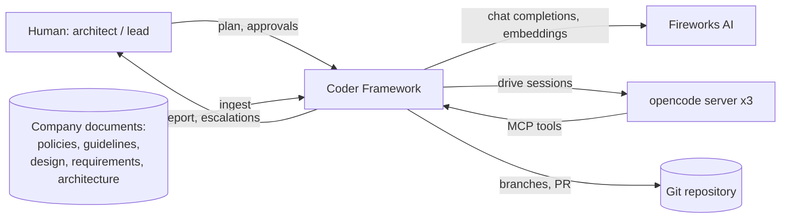
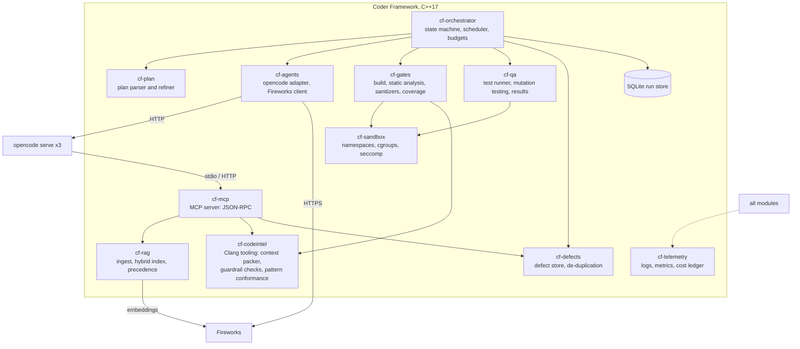
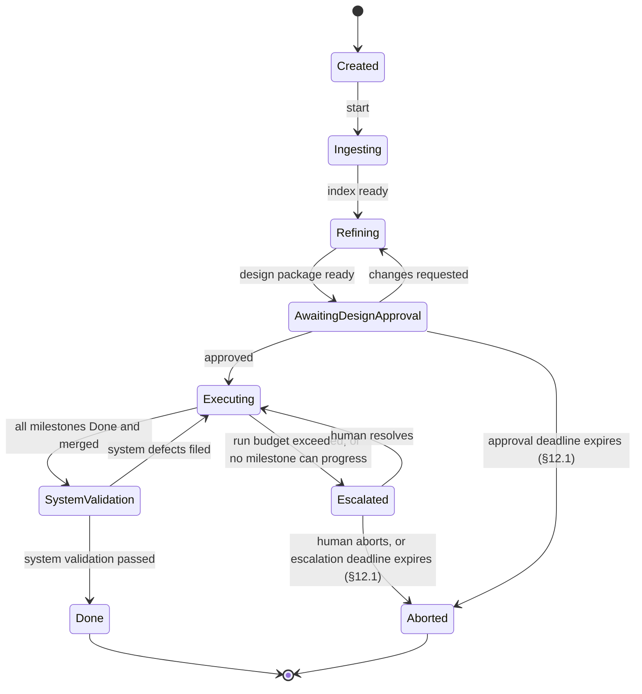
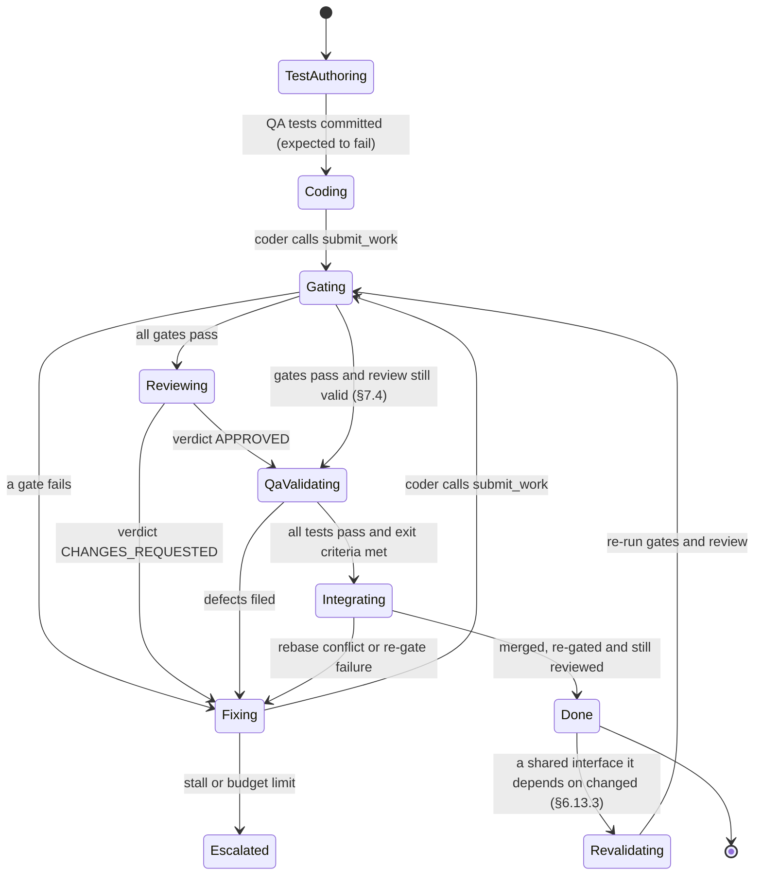
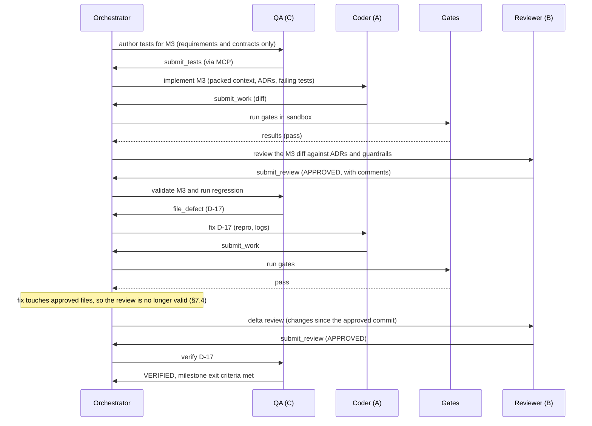

# Coder Framework (CF): Design Document

| Field | Value |
|---|---|
| Product | Coder Framework (CF): multi-agent, guardrail-driven code generation |
| Owner | Deepak Arora, Chief Technology & Product Officer, SwifTrade LLC |
| Status | Draft v1.8 (for review; second design review: MVP-first delivery, in-flight fencing, trusted vs. model commands, termination semantics) |
| Date | 2026-10-12 |
| Implementation language | Framework, including the Coder, Reviewer and QA agents: C++17. Generated product code: the language and standard named in the implementation plan |
| Agent harness | opencode (external process, driven by the C++ agents) |
| Model providers | Fireworks AI (hosted) by default; local vLLM for on-premises inference. Both use the OpenAI-compatible API |
| Default models | Coder: DeepSeek. Reviewer: Kimi. QA: GLM. Overridable per plan |
| Reviewers | Engineering leads, Security, QA lead |

---

## 1. Summary

The Coder Framework (CF) takes an **implementation plan** ("Agentic AI multicoder X for Product Y") and turns it into **reviewed, tested, policy-compliant code in the language the plan specifies**, with little human involvement. The framework itself, including all three agents, is written in **C++17**. It does this with three AI agents, each running on a different model:

- **Coder (Model A):** writes the code, one component at a time.
- **Reviewer (Model B):** reviews the code at defined milestones.
- **QA (Model C):** writes tests from the requirements, validates the system and files defects.

Each agent is a C++ component that drives an **opencode** session, and all three are coordinated by a **C++ orchestrator** that works as a deterministic state machine. They draw on company knowledge (policies, coding guidelines, design, requirements and architecture documents) through a **C++ retrieval (RAG) engine exposed as an MCP server**. The rules are **enforced by automatic checks** from a **toolchain profile** that matches the plan's target language (for C/C++: Clang-based custom checks, static analysis and sanitizers). RAG retrieval only advises the models.

The loop continues until a clearly defined **Definition of Done** is met. It always stops within a fixed iteration and cost budget, and it hands problems to a human when it stalls.

---

## 2. Goals and non-goals

### 2.1 Goals

| ID | Goal | Measure of success |
|---|---|---|
| G1 | Turn an approved implementation plan into working code in the plan's target language | ≥ 80% of plan milestones reach the Definition of Done with no human code edits (golden evaluation suite, §17) |
| G2 | Enforce company guardrails automatically | 100% of merged code passes all mandatory checks; 0 known violations of mandatory rules |
| G3 | Apply the right design patterns at system and component level | Every component has an Architecture Decision Record (ADR) recording its pattern choice; pattern-conformance checks pass |
| G4 | Make QA independent of the code it tests | Tests are derived from requirements; the coder cannot modify test files (enforced) |
| G5 | Always terminate, within budget | 100% of runs end in DONE, ESCALATED or ABORTED within the configured budget of **active time** (time not spent waiting for a person). Waiting for a person is bounded separately by approval deadlines (§12.1), so every run also ends within budget plus the deadlines |
| G6 | Make every decision auditable | Every LLM call, tool call, decision and document version is logged and traceable to a requirement |

### 2.2 Non-goals

- Building or hosting an inference engine. Fireworks serves the models.
- Replacing human architects. A human approves the refined design and makes all release decisions.
- Generating code in a language that has no toolchain profile (§6.7). v1 ships profiles for C/C++, Python, TypeScript/JavaScript (including Node.js and React), Java and Go; others are added as profiles, without changes to the framework.
- Fully autonomous deployment to production. CF stops at a merge-ready pull request.

---

## 3. Requirements

### 3.1 Functional requirements

| ID | Requirement | Priority |
|---|---|---|
| FR-01 | Accept an implementation plan (Markdown or YAML) and validate it against the plan schema (§8.1) | Must |
| FR-02 | Ingest company documents (policies, guidelines, design, requirements, architecture) with version, owner and precedence metadata | Must |
| FR-03 | Refine the plan into system-level and component-level designs with pattern selection, recorded as ADRs and interface contracts | Must |
| FR-04 | Require human approval of the refined design before any coding starts | Must |
| FR-05 | QA generates a test plan and test code from the requirements and interface contracts before the coder starts each component | Must |
| FR-06 | Run the Coder, Reviewer and QA agents through opencode, each with its own Fireworks model and its own git worktree | Must |
| FR-07 | Expose RAG, code intelligence and defect tools to the agents through MCP | Must |
| FR-08 | Run the automatic gates defined by the target language's toolchain profile (build, format, company guardrail checks, static analysis, tests, coverage, and sanitizers for C/C++) after every coder iteration | Must |
| FR-09 | The reviewer reviews each milestone's diff against the specs and guardrails and returns a structured verdict | Must |
| FR-10 | QA files structured, de-duplicated defects linked to requirement IDs | Must |
| FR-11 | Loop fix → gate → review → QA until the Definition of Done is met or a budget or stall limit is hit | Must |
| FR-12 | Escalate to a human with a complete evidence bundle when stalled or over budget | Must |
| FR-13 | Resume a run after a crash or restart without losing state | Must |
| FR-14 | Produce a final report: requirement traceability matrix, coverage, defect history, cost | Must |
| FR-15 | Support swapping the model for any role through configuration only | Should |
| FR-16 | Use mutation testing to measure how good the tests are | Should |
| FR-17 | Offer a dashboard showing a live run's state and cost | Could |
| FR-18 | Read the target language, language standard, build system and test framework from the plan's `target` block; reject the plan if no matching toolchain profile exists | Must |
| FR-19 | Push code to GitHub only through the orchestrator, only to `cf/` branches, and only after all pre-push checks pass; merge to protected branches only through a human-approved pull request (§10.4) | Must |
| FR-20 | Run every opencode session unattended: answer all permission prompts, questions and plan-approval requests automatically by policy (never with "Allow always"), log every decision, and escalate instead of waiting (§6.6.1) | Must |
| FR-21 | Give agents reference documentation (language and library docs) only from an approved, versioned, offline mirror; agents have no web access (§6.3.1) | Must |
| FR-22 | Record a durable intent with an idempotency key before every external side effect, and reconcile all unconfirmed intents on restart (§6.12) | Must |
| FR-23 | Run milestones in parallel only in isolated worktrees, under dependency-aware integration locks, and re-validate affected milestones when a shared interface changes (§6.13) | Must |

### 3.2 Non-functional requirements

| ID | Category | Requirement |
|---|---|---|
| NFR-01 | Reliability | Orchestrator state is persisted transactionally (SQLite in WAL mode). External side effects (opencode turns, git commits, GitHub pushes, pull requests, issues) follow the intent-and-reconcile protocol in §6.12, so a crash at any point can be resumed without duplicating or losing an effect |
| NFR-02 | Cost | Hard per-run and per-agent token and dollar limits; the run stops when a limit is reached |
| NFR-03 | Security | All builds and tests run in a sandbox (namespaces, cgroups, seccomp); no network except allow-listed endpoints |
| NFR-04 | Data governance | Only documents classified as sendable go to Fireworks; runs that use `restricted` documents use local vLLM only (§13.1); secrets are never placed in prompts |
| NFR-05 | Performance | RAG query p95 under 150 ms for up to 1M chunks; context packing under 2 s for a 500k-line codebase |
| NFR-06 | Portability | The framework runs on Linux x86_64 (Ubuntu 22.04+) and builds as strict C++17 (`-std=c++17`, no GNU extensions) with GCC 11+ and Clang 17+. Generated code targets whatever platforms the plan lists |
| NFR-07 | Observability | Structured JSON logs, per-run trace IDs, and OpenTelemetry-compatible metrics |
| NFR-08 | Maintainability | Each module has a public interface header, at least 80% unit-test coverage, and owns its own CMake target |
| NFR-09 | Determinism | Model temperature, seed (where supported), prompts and document versions are recorded so runs can be reproduced |

---

## 4. Key design decisions

| # | Decision | Rationale | Alternatives rejected |
|---|---|---|---|
| D1 | Write the framework, including the Coder, Reviewer and QA agents, in C++17 (ISO/IEC 14882:2017), with no C++20 features | Native access to Clang LibTooling (custom checks, AST-based context) and native vector search libraries (FAISS, hnswlib); low-level control over the sandbox; matches the team's target language | Python or TypeScript orchestrator: faster to build, but the Clang integration would still need C++ |
| D2 | Use opencode as the agent harness, in server mode | Mature support for tools, file editing and MCP; avoids building a harness | A custom harness: months of work with no advantage |
| D3 | Use a different model family for each role | Lowers the chance that the coder and reviewer make the same mistakes | One model for all roles |
| D4 | Guardrails in three tiers: RAG (advise), checks (enforce), human (approve) | RAG cannot guarantee compliance; automatic checks can | RAG-only guardrails |
| D5 | Tests come from requirements before code is written; test files are read-only for the coder | Prevents tests that simply confirm the code, and prevents the coder from "fixing" tests | QA writing tests from the code |
| D6 | The orchestrator is a deterministic state machine; agents never trigger each other directly | Predictable, testable and resumable behavior | Free-running agents talking to each other |
| D7 | One git worktree per agent; the orchestrator owns all merges | No conflicting edits; every change is an auditable git commit | A shared working directory |
| D8 | Expose RAG and code intelligence through MCP | opencode supports MCP natively; the tools are reusable by other harnesses | Pasting retrieved context into prompts |
| D9 | Put stable content at the start of every prompt | Maximizes provider-side prompt caching and lowers cost and latency | Ad-hoc prompt layout |
| D10 | The implementation plan decides the generated code's language; language-specific tools live in pluggable toolchain profiles | One framework serves products in different languages; adding a language means adding a profile, not changing the C++ code | Hard-coding C++ as the only target |
| D11 | Default models: DeepSeek (Coder and planner), Kimi (Reviewer), GLM (QA), all on Fireworks; overridable per plan | Three different model families, as D3 requires | Benchmark-only selection with no defaults |
| D12 | On-premises inference runs on vLLM on a local machine, behind the same OpenAI-compatible interface | Restricted documents never leave the company; switching provider is configuration only | A separate inference integration |


### 4.1 C++17 language baseline

This baseline applies to **the framework's own source code**: the orchestrator, the Coder, Reviewer and QA agents, and every other CF module. It does **not** apply to the code the agents generate, which follows §4.2. C++20 features are not allowed in the framework, and the framework's own CI enforces this with `-std=c++17 -Wpedantic -Werror` (Clang also uses `-Werror=c++20-extensions`).

| C++20 feature (not allowed) | C++17 replacement |
|---|---|
| `std::span` | `gsl::span` (gsl-lite), or pointer plus length |
| `std::format` | `fmt::format` (fmt library, already bundled with spdlog) |
| Concepts and `requires` | `std::enable_if_t`, `if constexpr`, `static_assert` with type traits |
| Coroutines (`co_await`) | Boost.Asio completion handlers, `std::future` |
| `std::jthread`, `std::stop_token` | `std::thread` with an atomic stop flag, joined in a RAII guard |
| Ranges (`std::ranges`, views) | Standard `<algorithm>` with iterators |
| Designated initializers | Constructors or named setters |
| `std::expected` (C++23) | `tl::expected` (an established C++11/14/17 implementation with the same interface), wrapped as `cf::Result<T>` (`include/cf/common/result.hpp`) |
| Three-way comparison (`<=>`) | Explicitly defined comparison operators |
| Modules | Headers with include guards or `#pragma once` |

C++17 features the team should use: `std::optional`, `std::variant`, `std::string_view`, `std::filesystem`, structured bindings, `if constexpr`, `[[nodiscard]]`, and class template argument deduction.

**Error handling across module boundaries** uses `cf::Result<T>`. Rather than a hand-written `std::variant<T, Error>`, which needs special handling for `void`, references and value types that overlap with `Error`, CF uses the `tl::expected` library (available in vcpkg as `tl-expected`). Its interface matches C++23 `std::expected`, so moving to the standard type later is a rename.

```cpp
// include/cf/common/result.hpp
#include <tl/expected.hpp>

namespace cf {

struct Error {
  std::string code;      // stable identifier, e.g. "RAG_INDEX_MISSING"
  std::string message;   // human-readable detail
};

template <typename T>
using Result = tl::expected<T, Error>;

using Status = Result<void>;                       // for operations with no value

inline tl::unexpected<Error> fail(std::string code, std::string msg) {
  return tl::make_unexpected(Error{std::move(code), std::move(msg)});
}

}  // namespace cf
```

**Template contract** (checked with `static_assert` in a `cf::Result` helper header and enforced by code review):

| `T` | Allowed? | Rule |
|---|---|---|
| A value type (`int`, `std::string`, a struct) | Yes | The normal case |
| `void` | Yes | Use `cf::Status` |
| A reference (`Foo&`) | **No** | Return `Foo*` (non-owning, never null on success) or `std::reference_wrapper<Foo>` |
| `cf::Error`, or a type convertible to or from it | **No** | Rejected at compile time, so success and failure can never be confused |
| `std::optional<U>` | Yes, when "missing" is a normal outcome distinct from an error | For example a lookup that may find nothing |
| A move-only type (`std::unique_ptr<U>`) | Yes | Moved out with `std::move(result).value()` |

Usage rules:

- Every function that can fail at a module boundary returns `Result<T>` or `Status`; exceptions don't cross module boundaries. Code that calls throwing third-party libraries catches at the boundary and converts to `cf::Error`.
- Callers must check `has_value()` (or use `and_then` / `map` / `or_else`) before calling `value()`. Calling `value()` on an error is a bug: in CF builds it logs the error and calls `std::terminate` (configured through the library's no-exceptions mode).
- `Error::code` values are listed in one registry header, so logs, metrics and escalations use stable codes.

### 4.2 Language of the generated code

The implementation plan decides the language of the code the agents produce. The plan's `target` block (§8.1) names the language, the language standard, the build system and the test framework, for example C++20 with CMake and GoogleTest, C11 with Make and Unity, or Python 3.12 with pytest.

The framework uses that block to:

1. **Select a toolchain profile** (§6.7) that supplies the format, build, lint, analysis, test, coverage and mutation tools for that language. A plan whose target has no profile is rejected at validation (FR-18).
2. **Fill in the agents' prompts** with the target language and standard, so the coder writes, for example, C++20 when the plan asks for C++20, even though the framework itself is C++17.
3. **Filter RAG retrieval** to the coding guidelines and pattern catalog entries for that language.
4. **Choose code-intelligence back ends** (§6.5): Clang for C and C++, tree-sitter for other languages.

---

## 5. Architecture overview

### 5.1 Context



### 5.2 Components



### 5.3 Runtime layout

| Process | Count | Model | Worktree | Write access |
|---|---|---|---|---|
| `cf-orchestrator` | 1 per run (holds the run lease, §6.12.6) | none | main repo | Creates all commits; local merges; the only process allowed to push to GitHub (§10.4) |
| `opencode serve` (Coder) | 1 per active milestone | A | `wt/<run>/<milestone>/coder` | `src/`, `include/` (not `tests/`), through the writable source mounts in §6.8 |
| `opencode serve` (Reviewer) | 1 per active milestone | B | `wt/<run>/<milestone>/review` (read-only) | None; returns verdicts through MCP |
| `opencode serve` (QA) | 1 per active milestone | C | `wt/<run>/<milestone>/qa` | `tests/`, `qa/` only |
| `cf-mcp` | 1 per opencode server (stdio) | none | read-only | Defect store and its own intent records only |

Worktrees are scoped by **run, milestone and role**, so two milestones running in parallel never share a working directory (§6.13). The number of active milestones is capped (`scheduler.max_parallel_milestones`, default 2).

Agents never run `git add` or `git commit`. When a turn ends, the orchestrator freezes the agent's processes, snapshots the allowed paths and creates the commit itself (§6.8.3). Write permissions are enforced three times: by the filesystem mounts (§6.8), by the opencode permission settings, and by the orchestrator rejecting any snapshot that touches files outside the role's allowed paths (§10.3).

---

## 6. Component design

### 6.1 cf-orchestrator

**Responsibilities:** owns the run's state machine (§7), schedules agent tasks, enforces budgets and stall detection, owns git merges, triggers human approval gates, and persists every transition.

**Key types:**

```cpp
namespace cf::orch {

// Run-level states (§7.1). A run is in Executing while any milestone is active.
enum class RunState {
  Created, Ingesting, Refining, AwaitingDesignApproval,
  Executing, SystemValidation, Done, Escalated, Aborted
};

// Milestone-level states (§7.2). Each milestone has its own state machine.
enum class MilestoneState {
  Pending,          // dependencies not yet done
  Blocked,          // waiting for an integration or interface lock (§6.13)
  TestAuthoring, Coding, Gating, Reviewing, QaValidating, Fixing,
  Integrating,      // merging into the integration branch, re-gating after rebase
  Revalidating,     // a shared interface it depends on changed (§6.13.3)
  Done, Escalated
};

struct Budget {
  uint64_t max_tokens_total;
  double   max_usd_total;
  uint32_t max_iterations_per_milestone;
  uint32_t max_attempts_per_defect;
  std::chrono::minutes max_wall_clock;
};

class StateMachine {
 public:
  explicit StateMachine(RunStore& store, EventBus& bus);
  // Applies an event, validates the transition, and persists the new state
  // together with any side-effect intents (§6.12) in one SQLite transaction.
  Result<RunState> apply(const Event& ev);
  Result<MilestoneState> apply(const MilestoneId& m, const Event& ev);
  RunState current() const;
  MilestoneState current(const MilestoneId& m) const;
 private:
  RunStore& store_;
  EventBus& bus_;
};

class Scheduler {
 public:
  // Picks the next milestone or task based on the dependency graph from the refined plan.
  std::optional<Task> next(const RunContext& ctx);
};

class BudgetGuard {
 public:
  // Throws BudgetExceeded; the orchestrator moves the run to Escalated.
  void charge(AgentRole role, const Usage& usage);
};

}  // namespace cf::orch
```

**Concurrency:** Boost.Asio `io_context` with a strand per milestone, using completion handlers and `std::future` (C++20 coroutines are not available). Milestones may run in parallel only under the rules in §6.13; the three roles for one milestone run in sequence as its state machine requires.

### 6.2 cf-plan: plan parser and refiner

**Input:** an implementation plan (Markdown with YAML front matter, or pure YAML) matching the schema in §8.1.

**Refinement pipeline:**

1. **Parse and validate** against the schema; reject plans with unresolved requirement IDs.
2. **System-level design:** the planner model (DeepSeek by default, the same family as the Coder) is prompted with the plan, retrieved architecture documents and the pattern catalog. It produces a component breakdown, layering, cross-cutting concerns (error handling, logging, concurrency model, memory ownership) and system-level pattern choices (for example layered, hexagonal, pipeline, actor).
3. **Component-level design:** for each component, interface contracts (C++ headers with doc comments and pre- and post-conditions), component-level patterns (for example Strategy, Factory, RAII wrappers, PIMPL, Observer, CRTP) and an ADR recording the choice and the alternatives considered.
4. **Milestone graph:** a directed acyclic graph (DAG) of milestones, each with entry and exit criteria and mapped requirement IDs.
5. **Self-critique:** Model B reviews the design against the guardrails and pattern catalog; the planner revises once.
6. **Human approval gate:** the design package is presented; the run waits in `AwaitingDesignApproval`.
7. **Feed back into RAG:** once approved, the ADRs, interface contracts and component designs are ingested into cf-rag as `design` documents, tagged with `product`, `source_run`, `status: approved` and the approval date. Future runs can reuse proven designs and stay consistent with earlier decisions. Rules:
   - The current run's own approved design always takes precedence over designs from earlier runs.
   - Designs from earlier runs are retrieved only for the same product, unless a plan explicitly allows reuse across products.
   - When a later run replaces a design, the old one is marked `status: superseded` and is no longer returned by default.
   - Designs from a run that is later aborted, or whose pull request is rejected, are marked `status: withdrawn` and not retrieved.

**The pattern catalog** is a curated RAG collection (§6.3) with one entry per approved pattern:

```yaml
id: PAT-STRATEGY
name: Strategy
level: component
use_when: ["several interchangeable algorithms", "algorithm chosen at runtime"]
avoid_when: ["only one implementation is foreseeable", "hot path where indirect calls matter"]
company_notes: "Prefer std::function or templates over virtual inheritance in latency-critical modules."
reference_impl: "repo://libs/pricing/strategy/"
conformance_checks:                         # one per language that has a check (§6.5)
  cpp: "cf-pattern-strategy"                 # clang-tidy check ID
  python: "swt.pattern.strategy"             # Semgrep rule ID
```

### 6.3 cf-rag: retrieval engine

**Ingestion**

| Step | Detail |
|---|---|
| Parse | Markdown, PDF (via poppler), DOCX (via a Pandoc pre-conversion), source code |
| Chunk | Structure-aware: by heading for documents, by function or class for code (using cf-codeintel); 300–800 tokens with 15% overlap |
| Metadata | `doc_id`, `doc_type` (policy, guideline, design, requirements, architecture, pattern, external_reference), `version`, `owner`, `effective_date`, `classification`, `precedence` |
| Embed | Fireworks embeddings endpoint, in batches; the model and dimension are recorded per index |
| Index | hnswlib (default) or FAISS (IVF-PQ for collections over 5M chunks) plus a BM25 inverted index |

**Query path:** hybrid retrieval (BM25 and vector, combined with Reciprocal Rank Fusion) → optional rerank → **precedence resolution** → top-k results with citations.

**Precedence when documents conflict** (highest first):

1. Company policy (legal, security, compliance)
2. Requirements
3. Architecture
4. Design documents and ADRs
5. Coding guidelines
6. Pattern catalog
7. External reference documentation (the offline mirror, §6.3.1)

Precedence alone can't settle every conflict, so retrieval resolves them in four steps:

1. **Applicability filter.** Every chunk carries `scope` (company, product, component or language), `effective_from` / `effective_to`, and `status` (active, draft, superseded, withdrawn). Only active chunks whose scope matches the run's product, component and target language, and which are in effect on the run's start date, are considered.
2. **Precedence by document type** (the list above). A higher type always wins over a lower one; for example, a policy beats a coding guideline whatever their scopes.
3. **Within the same type:** the more specific scope wins (component over product over company), then the later effective date. A written exception or waiver document that names the rule it overrides wins over the rule.
4. **Escalate what can't be resolved.** Two conflicting chunks of the same type, scope and date, or any conflict between two requirements, or between a requirement and a policy, is never resolved automatically. The run records it as a requirement ambiguity and escalates (§12).

The winning chunk is returned flagged `conflict: true`, with the losing chunks under `overridden_by` and the rule that decided it. Every detected conflict is also written to a **conflict register** that document owners review, so the documents themselves get fixed.

Conflict detection is partly heuristic. Explicit rule IDs (for example `CG-4.2`) make conflicts between rules exact; for free text, a model-based check compares retrieved chunks that address the same topic. Missed conflicts (false negatives) are the dangerous case, because the agent then follows one rule without knowing another contradicts it. So detection is measured against an **adversarial conflict set** of at least 100 cases, built and maintained by the document owners and QA:

| Category | Example |
|---|---|
| Paraphrase | "All public functions must be documented" vs. "Doc comments are optional for internal-facing APIs" |
| Negation and exceptions | "Exceptions are forbidden" vs. "Exceptions may be used inside the parser module" |
| Numeric thresholds | "Line coverage ≥ 80%" vs. "Line coverage ≥ 85%" |
| Hidden scope | A company rule and a product rule that only conflict for one component |
| Split across chunks | The rule in one chunk, the exception three sections later |
| Time | A rule superseded by a newer one with a different effective date |
| Cross-type | A pattern catalog entry that contradicts a coding guideline |
| Indirect | Two requirements that can't both be met, without contradicting each other in words |
| Non-conflicts | Similar wording that doesn't conflict, to measure false alarms |

Targets: conflict recall of at least 0.90 overall and at least 0.95 for conflicts involving policies or requirements, with precision reported. Because recall can't reach 1.0, three further safeguards apply: document templates require rule IDs for mandatory rules (which makes detection exact), the Reviewer's prompt asks it to flag any guidance in its retrieved context that seems to contradict another piece, and missed conflicts found later are added to the adversarial set.

**Interface:**

```cpp
namespace cf::rag {

struct Query {
  std::string text;
  std::vector<DocType> types;      // empty = all
  uint32_t top_k = 8;
  std::optional<std::string> as_of_version;
};

struct Hit {
  std::string chunk_id, doc_id, version, text, citation;
  DocType type;
  float score;
  bool conflict = false;
  std::vector<std::string> overridden_by;
};

class Retriever {
 public:
  virtual ~Retriever() = default;
  virtual Result<std::vector<Hit>> search(const Query& q) = 0;
  virtual Result<Document> get(std::string_view doc_id,
                               std::optional<std::string_view> version) = 0;
};

}  // namespace cf::rag
```

**Retrieval quality:** a labeled evaluation set of at least 200 queries per collection with known relevant chunks. CI fails if recall@8 drops below 0.85 or MRR below 0.6.

#### 6.3.1 Offline reference documentation mirror

The agents have no web access (§6.6.3). They get language and library documentation from an **offline mirror**: approved documentation sets downloaded ahead of time by a separate job, then indexed in cf-rag as `external_reference`, the lowest precedence.

**Approved sets.** Listed in `reference-docs/manifest.yaml`, which changes only through a pull request approved by a tech lead:

| Source | How it is obtained |
|---|---|
| cppreference | Its official offline HTML archive |
| Boost | The `doc/` and `libs/*/doc/html` folders from the release archive of the pinned version |
| Vendor SDKs | Documentation bundled with the SDK, or the vendor's downloadable docs, at the version shipped |
| Language and runtime docs | The JDK API docs for Java, `go doc` output generated from the Go standard library for Go, and the Node.js and React documentation archives, each at the pinned version |
| Libraries the plans use | Generated from the library's source at the pinned version: Doxygen for C/C++, Sphinx or type stubs for Python, `.d.ts` files for TypeScript/JavaScript, Javadoc for Java, `go doc` for Go |

```yaml
# reference-docs/manifest.yaml
sets:
  - id: cppreference
    version: "2026-09"
    source: https://<cppreference offline archive URL>
    sha256: "<checksum>"
    license: CC-BY-SA-3.0
  - id: boost
    version: "1.89.0"
    source: https://<boost release archive URL>
    extract: ["doc/html", "libs/*/doc/html"]
    sha256: "<checksum>"
    license: BSL-1.0
  - id: nlohmann-json
    version: "3.12.0"
    generate: doxygen
    repo: https://github.com/nlohmann/json
    ref: v3.12.0
    license: MIT
schedule: monthly        # and whenever a pinned dependency version changes
```

**The mirroring job** (`cf-refmirror`, a C++17 command-line tool run as a scheduled CI job, outside any agent sandbox):

1. Read the manifest. Only the URLs and repositories listed there are contacted.
2. Download each set and **verify its checksum**. A mismatch stops the job for that set and alerts the owner; the set must be re-approved.
3. **Clean** the content: HTML is converted to Markdown, and navigation, scripts, comments and adverts are removed.
4. **Scan for injected instructions**: text that addresses an AI or gives commands ("ignore previous instructions", "you must also…") is flagged, and the set is held for human review.
5. **Chunk by API entity** (one function, class or page section per chunk).
6. **Tag** each chunk with `library`, `version`, `source_url`, `license` and `doc_type: external_reference`.
7. **Ingest** into cf-rag as a new, versioned index. The raw snapshot is kept in artifact storage for audit and re-indexing.
8. **Publish** the index version. A run records the version it started with and keeps using it, so results stay reproducible.

**Version matching.** When an agent looks something up, cf-rag returns the documentation for the version listed in the target project's dependency file (for example `vcpkg.json`, `requirements.txt` or `package.json`). If that version isn't mirrored, the tool says so, so the agent doesn't silently get another version's docs.

**Gaps.** If the mirror doesn't cover what an agent needs, `lookup_reference` returns "not covered". The agent records the gap in its `submit_work` summary. Repeated gaps for the same library are escalated, so a person can add the set to the manifest. Agents never fall back to guessing an API.

**Limits.** The mirror is safer than web access, not risk-free. Official documentation can contain errors, and a publisher could be compromised before a download; checksums only prove the file didn't change after approval. The reviewer, the gates and the tests still check every change. The mirror can also lag behind new releases; the monthly refresh plus re-runs on version changes keep that gap small.

### 6.4 cf-mcp: MCP server

A JSON-RPC 2.0 server implementing MCP over **stdio** (each opencode instance launches its own) and **streamable HTTP** (one shared instance). It is built on nlohmann/json and Boost.Beast. Tools available to each role are restricted (§9.1).

### 6.5 cf-codeintel: code intelligence

cf-codeintel is written in C++17 and has one back end per language family, chosen by the plan's `target` block:

| Target language | Parsing back end | Company guardrail checks |
|---|---|---|
| C, C++ | Clang LibTooling, using the `compile_commands.json` from the target's build | Custom clang-tidy checks (plugin `.so`) |
| Other languages (Python, TypeScript, Go, Java and so on) | tree-sitter (a C library, linked directly into cf-codeintel) | Semgrep rules, written once per guideline rule |

Every back end implements the same C++ interface, so the context packer, symbol index and MCP tools work identically for every language:

```cpp
namespace cf::codeintel {

class LanguageBackend {
 public:
  virtual ~LanguageBackend() = default;
  virtual std::string_view language() const = 0;     // "cpp", "python", ...
  virtual Result<SymbolGraph> index(const std::filesystem::path& root) = 0;
  virtual Result<SymbolGraph> update(const SymbolGraph& g,
                                     const std::vector<std::filesystem::path>& changed) = 0;
  virtual Result<std::vector<Diagnostic>> check_architecture(const SymbolGraph& g,
                                                             const ArchitectureRules& rules) = 0;
};

class BackendRegistry {
 public:
  void add(std::unique_ptr<LanguageBackend> backend);
  Result<LanguageBackend*> for_language(std::string_view language) const;
};

}  // namespace cf::codeintel
```

The subsystems below work on top of whichever back end is active.

| Subsystem | Purpose | Output |
|---|---|---|
| **Symbol index** | AST index of classes, functions, includes and call edges | SQLite tables, updated incrementally per commit |
| **Context packer** | For a task, collects the target component's headers, the signatures of its direct dependencies, its callers' signatures, relevant ADRs and contracts, all within a token budget | A packed context block of up to N tokens, ranked by relevance |
| **Guardrail checks** | Company rules as custom clang-tidy checks (C/C++) or Semgrep rules (other languages) | Diagnostics with a rule ID and a link back to the guideline document |
| **Pattern conformance** | Checks the code matches the ADR's chosen pattern (for example, all creation of `IFoo` goes through `FooFactory`) | Pass or fail with locations |
| **Architecture rules** | Layering and dependency rules from the architecture document (for example, `domain/` must not include `infra/`) | Violations listed as include and call edges |

**Example custom check (C/C++ profile):**

The rule is "ownership must use smart pointers" (Coding Guidelines §4.2). The check flags every `new` expression in project code, except placement `new`, code in system headers, and code inside namespaces the guideline explicitly exempts (for example a custom allocator). Calls to `std::make_unique` never contain a `new` expression in user code, so excluding them with an ancestor matcher (as an earlier draft did) had no effect.

```cpp
// cf-swt-no-raw-new  (CG-4.2)
class NoRawNewCheck : public clang::tidy::ClangTidyCheck {
 public:
  NoRawNewCheck(llvm::StringRef name, clang::tidy::ClangTidyContext* ctx)
      : ClangTidyCheck(name, ctx),
        allowed_ns_(Options.get("AllowedNamespaces", "")) {}

  void storeOptions(clang::tidy::ClangTidyOptions::OptionMap& opts) override {
    Options.store(opts, "AllowedNamespaces", allowed_ns_);
  }

  void registerMatchers(clang::ast_matchers::MatchFinder* f) override {
    using namespace clang::ast_matchers;
    auto in_allowed_ns = allowed_ns_.empty()
        ? namespaceDecl(unless(anything()))
        : namespaceDecl(matchesName(allowed_ns_));   // regex from configuration
    f->addMatcher(
        cxxNewExpr(unless(isExpansionInSystemHeader()),
                   unless(hasAnyPlacementArg(anything())),
                   unless(hasAncestor(in_allowed_ns)))
            .bind("new"),
        this);
  }

  void check(const clang::ast_matchers::MatchFinder::MatchResult& r) override {
    const auto* e = r.Nodes.getNodeAs<clang::CXXNewExpr>("new");
    diag(e->getBeginLoc(),
         "raw 'new' violates CG-4.2; use std::make_unique or std::make_shared");
  }

 private:
  std::string allowed_ns_;
};
```

The code is illustrative; the exact matcher names must be checked against the pinned LLVM version. Every check ships with AST fixture tests, and a check is not enabled as a blocking gate until its fixtures pass:

| Fixture | Expected |
|---|---|
| `auto p = new Foo();` | Flagged |
| `std::unique_ptr<Foo> p(new Foo());` | Flagged (should be `std::make_unique`) |
| `new (buffer) Foo();` (placement) | Not flagged |
| `auto p = std::make_unique<Foo>();` | Not flagged |
| `new` inside an exempt allocator namespace | Not flagged |
| `new` expanded from a macro defined in a system header | Not flagged |
| `new` in a project macro used in project code | Flagged, at the macro use site |
| Array `new Foo[n]` | Flagged (should be `std::vector` or `std::make_unique<Foo[]>`) |

**Mapping guidelines to checks:** every mandatory rule in the coding guidelines document gets a rule ID (for example `CG-4.2`). A coverage report lists which rules have an automatic check, which are reviewer-only, and which have no check yet. The target is at least 70% automated by release 1.0.

### 6.6 cf-agents: the C++ agents, opencode adapter and Fireworks client

The Coder, Reviewer and QA agents are **C++17 classes** in the framework. Each one builds its prompts, chooses what context to retrieve, drives an opencode session through the adapter, checks the structured result and reports it to the orchestrator. opencode performs the file edits and tool calls; the C++ agent decides what the model is asked to do and whether the result is acceptable.

```cpp
namespace cf::agents {

enum class AgentRole { Coder, Reviewer, Qa };

struct TaskSpec {
  std::string run_id, milestone_id, task_id;
  plan::TargetSpec target;                  // language, standard, build system, test framework
  std::vector<std::string> requirement_ids;
  std::vector<std::string> open_defect_ids;
  std::optional<gates::GateReport> last_gates;
};

class Agent {
 public:
  virtual ~Agent() = default;
  virtual AgentRole role() const = 0;
  // Runs one turn: builds the prompt, drives opencode, validates the
  // structured result (submit_work, submit_review or submit_tests).
  virtual Result<TurnOutcome> run_turn(const TaskSpec& task) = 0;
};

class CoderAgent final : public Agent {
 public:
  CoderAgent(OpencodeClient& opencode, PromptBuilder& prompts,
             codeintel::ContextPacker& packer, telemetry::CostLedger& ledger);
  AgentRole role() const override { return AgentRole::Coder; }
  Result<TurnOutcome> run_turn(const TaskSpec& task) override;
 private:
  OpencodeClient& opencode_;
  PromptBuilder& prompts_;
  codeintel::ContextPacker& packer_;
  telemetry::CostLedger& ledger_;
};

// ReviewerAgent and QaAgent follow the same shape.

}  // namespace cf::agents
```

`PromptBuilder` fills the role prompt template with the plan's target language and standard (§4.2), so the generated code follows the plan and not the framework's own C++17 baseline.

**opencode integration:**

- Each role runs `opencode serve --port <p>` with a role-specific `opencode.json` (models, permissions, MCP servers).
- The orchestrator drives each session over opencode's HTTP API: creates a session, sends the task prompt, streams events, and collects the resulting diff and tool calls.
- The orchestrator never relies on free-form text in the model's reply. Every agent **must end its turn by calling an MCP tool** (`submit_work`, `submit_review` or `file_defect`), so the result arrives in a structured form.

**Example role configuration (Coder):**

```json
{
  "$schema": "https://opencode.ai/config.json",
  "provider": {
    "fireworks": {
      "npm": "@ai-sdk/openai-compatible",
      "options": { "baseURL": "https://api.fireworks.ai/inference/v1",
                   "apiKey": "{env:FIREWORKS_API_KEY}" },
      "models": { "coder-a": { "id": "accounts/fireworks/models/<deepseek-model>" } }
    },
    "local-vllm": {
      "npm": "@ai-sdk/openai-compatible",
      "options": { "baseURL": "http://<vllm-host>:8000/v1", "apiKey": "{env:VLLM_API_KEY}" },
      "models": { "coder-a-local": { "id": "<local-deepseek-model>" } }
    }
  },
  "model": "fireworks/coder-a",
  "permission": {
    "edit": "allow",
    "webfetch": "deny",
    "bash": {
      "cmake *": "allow", "ninja *": "allow", "ctest *": "allow",
      "git status*": "allow", "git diff*": "allow", "git log*": "allow",
      "git add*": "deny", "git commit*": "deny", "git push*": "deny",
      "git remote*": "deny", "git config*": "deny", "git reset*": "deny",
      "curl *": "deny", "wget *": "deny", "ssh *": "deny", "sudo *": "deny",
      "*": "ask"
    }
  },
  "mcp": {
    "cf": { "type": "local", "command": ["cf-mcp", "--role=coder", "--run=${CF_RUN_ID}"] }
  }
}
```

For on-premises runs (§13.1), CF generates the same file with `"model": "local-vllm/coder-a-local"`.

> Exact opencode configuration keys, permission types, event names and API routes must be checked against the opencode version pinned in `third_party/VERSIONS` during Phase 0.

The `bash` allow-list above is generated from the active toolchain profile (§6.7.3), so a Python target allows `pytest *` and `ruff *` instead of `cmake *`. Anything not matched falls through to `"ask"`, which the Permission Broker answers (§6.6.1); a human never sees it.

#### 6.6.1 Unattended operation: permission prompts, questions and plan approval

opencode is built for a person at a terminal. It can stop and wait for an answer: a permission prompt ("Allow once / Allow always / Reject"), a question from the model ("Should I continue?"), or a plan waiting to be approved. If nobody answers, the run hangs. CF must answer every one of these automatically, according to policy, and never by blindly saying yes.

The framework handles this in four layers:

**Layer 1: decide in advance (static configuration).** Each role's `opencode.json` is generated from policy, so almost every action is already `allow` or `deny` and raises no prompt:

| Role | `edit` | `bash` | `webfetch` | Anything else |
|---|---|---|---|---|
| Coder | allow (paths are checked again at submission, §10.3) | Profile's build, test and read-only git commands: allow. Push, remote, network and privilege commands: deny. Rest: ask | deny | ask |
| Reviewer | deny | Read-only commands (`git diff`, `git log`, `grep`, `cat`): allow. Rest: deny | deny | deny |
| QA | allow (test paths only, checked at submission) | Profile's test, coverage and fuzz commands: allow. Push, remote, network and privilege commands: deny. Rest: ask | deny | ask |

**Layer 2: the Permission Broker answers whatever is left.** `PermissionBroker` is a C++ component in cf-agents. It subscribes to each opencode server's event stream, catches every permission request, decides it against a policy file, and replies through opencode's API.

```cpp
namespace cf::agents {

enum class PermissionReply { Once, Reject };   // "Always" is never sent

struct PermissionRequest {
  std::string session_id, request_id;
  AgentRole role;
  std::string type;              // "bash", "edit", "webfetch", or another type opencode raises
  std::string command_or_path;   // e.g. "make -j8" or "src/registry/registry.cpp"
};

struct PermissionDecision {
  PermissionReply reply;
  std::string rule_id;           // the policy rule that matched, for the audit log
  std::string reason;            // returned to the agent when the request is rejected
};

class PermissionBroker {
 public:
  PermissionBroker(OpencodeClient& opencode, const PermissionPolicy& policy,
                   telemetry::AuditLog& audit);
  // Called for every permission event from any opencode server.
  PermissionDecision handle(const PermissionRequest& req);
};

}  // namespace cf::agents
```

Policy rules, in order:

1. **Deny list wins.** Anything matching a deny rule is rejected, whatever else matches.
2. **Allow only inside the agent's own worktree and sandbox.** Paths are resolved to absolute form first, so `../` and symbolic links can't escape.
3. **Allow only simple commands that match the active toolchain profile** for that role. The broker parses each command with a POSIX shell parser before matching, and treats as unmatched (so rejected) any command that contains:
   - chaining or pipes (`;`, `&&`, `||`, `|`, `&`), command substitution (`$(...)`, backticks) or process substitution;
   - redirection to a path outside the role's writable mounts;
   - a wrapper that runs another command (`bash -c`, `sh -c`, `env`, `xargs`, `nohup`, `timeout`, `find -exec`, `python -c`, `node -e`), unless the profile explicitly lists that exact form.

   Pattern matching is only a first filter. The real boundary is the kernel-level sandbox in §6.8, which holds even if a command slips through.

   These rules apply only to **model-generated commands**. Toolchain profile steps (§6.7.3) are trusted, reviewed configuration that the gate runner executes itself as argument lists, never through a shell and never through opencode, so they are not subject to the broker.
4. **Reject everything else** (default deny), with a reason the agent can act on, such as "network access is not permitted; use the lookup_reference tool".
5. **Never answer "Allow always".** Every request is decided separately, so permission can't quietly widen during a session and every decision appears in the audit log.
6. **Unknown permission types** (for example, ones added in a newer opencode version) are rejected and flagged for a policy update.

Every decision is logged with the request, the matching rule and the reply. If the same agent has 3 requests rejected in one turn, that counts as a stall (§12).

**Layer 3: no questions, no waiting.** The models are told never to ask for confirmation, but they sometimes do anyway. The orchestrator handles this:

| What happens | How CF responds |
|---|---|
| The model ends a turn without calling its `submit_*` tool (for example, it asks "Shall I proceed?") | The orchestrator sends a fixed continuation message: "Proceed with the task as specified. Do not ask questions. Finish by calling submit_work." It does this at most twice; a third time counts as a failed iteration |
| The model asks a real clarifying question (for example, two requirements conflict) | The question is answered from RAG if a high-precedence document covers it. Otherwise it is recorded as a requirement ambiguity and the run escalates; CF never makes up an answer |
| opencode presents a question or choice that CF doesn't recognise | Answered with the safe default (reject or cancel), logged, and counted toward the stall limit |
| A session sits waiting with no events for 120 seconds | The watchdog aborts the turn and retries once; a second time escalates |

**Layer 4: plan approval stays with CF.** The agents run as opencode's normal working ("build") agent, configured per role. opencode's separate planning mode is not used, because planning is done by cf-plan (§6.2). The only plan approval is CF's own human design approval gate (§7.1), and no agent can approve it. If a session nonetheless produces something waiting for plan approval, the broker rejects it and tells the agent to work from the approved design.

**Defence in depth.** These answers are a convenience, not the security boundary. Each opencode server itself runs inside a sandbox (§6.8) with no GitHub credentials and no network access other than Fireworks and the local cf-mcp. A wrongly allowed command still can't push code, reach the internet or leave the worktree.

#### 6.6.2 Harness compatibility contract (Phase 0 go/no-go)

The whole architecture depends on opencode behaving reliably without a person present, and none of its HTTP API, MCP submission, cancellation or permission semantics has been verified yet. Phase 0a is therefore a **mandatory architectural gate**: no Phase 0b or later work starts until the CTO signs off the go decision. The spike that must pass every scenario below against the pinned opencode version, at least 20 times each, driven from the C++ adapter:

| # | Capability or scenario | Pass condition |
|---|---|---|
| H1 | Start a session, send a task, stream events to completion | All events received in order; final state matches |
| H2 | Structured submission through an MCP tool (`submit_work`) | Received with valid JSON every time; the turn ends after the call |
| H3 | Permission prompt answered by the broker (once and reject) | The run continues correctly in both cases; no "always" grant is stored |
| H4 | Every permission type the pinned version can raise | Each is detected and answered; unknown types are rejected safely |
| H5 | MCP tool returns an error, times out, or returns invalid JSON | The model recovers or the turn fails cleanly; no hang |
| H6 | Model sends malformed tool arguments | Schema error returned; the model retries or the turn fails cleanly |
| H7 | Event stream drops and reconnects | Missed events are detected (sequence gap or state poll) and the session state is recovered |
| H8 | opencode server killed mid-turn | The adapter detects it within 10 s; the turn is recovered per §6.12 |
| H9 | Turn cancelled by the orchestrator (watchdog) | The session stops; no further file changes after the cancel |
| H10 | The model asks a question instead of submitting | Detected; the continuation message works within two attempts |
| H11 | Provider errors (429, 5xx, timeout) from Fireworks and from local vLLM | Retries with backoff, or a clean failure reported to the adapter |
| H12 | Tool calling with each default model family (DeepSeek, Kimi, GLM), on Fireworks and on local vLLM | Tool-call success rate ≥ 95% on the spike's task set |
| H13 | Permission request semantics: does the session block while waiting; what happens to a reply that arrives after a cancel, a timeout or a server restart | Documented behaviour; no reply is ever applied to the wrong request |
| H14 | Cancellation semantics: what a cancel does to a running tool call and a pending permission request | No file change and no tool call completes after the cancel is acknowledged |
| H15 | Several sessions on one server, and session state after a server restart | Sessions are isolated; restart behaviour is documented and handled by the adapter |

**Decision at the end of the spike:**

- **Go:** all scenarios pass. Build continues on opencode.
- **Conditional go:** a small number fail but can be worked around in the adapter (for example by polling state instead of relying on an event). Workarounds are recorded and re-tested on every opencode upgrade.
- **No-go:** a foundational scenario (H1, H2, H3, H7, H8, H13 or H14) can't be made reliable. CF then replaces opencode with a **minimal C++ harness** that calls the model's tool-calling API directly and implements file read, edit and command tools itself. The rest of the architecture is unchanged, because the agents already talk to opencode only through the `OpencodeClient` adapter interface. This fallback adds roughly 4–6 weeks.

The same scenario suite runs in CI against every opencode version before it can be pinned.

#### 6.6.3 No web access for agents

`webfetch` (and any web search tool) is denied for all three roles. Reference documentation comes from the offline mirror (§6.3.1) through the `lookup_reference` MCP tool instead.

| Risk | Web access during a run | Offline mirror |
|---|---|---|
| Who chooses the source | The model, at run time, from whatever ranks highly | A person, ahead of time, through the reviewed manifest |
| Prompt injection | Anyone who can publish a page can try it, and the agent reading it can write code | Only a few trusted publishers; content cleaned and scanned before indexing |
| Data leaving the company | Every query and URL is an outbound request that can carry code or requirement text | No outbound requests from agents; the mirroring job sends no company data |
| Tampering | Pages can change between fetches without notice | Checksums verified; a change needs re-approval |
| Wrong version | Results mix versions and quality | Docs for the exact versions the project builds against |
| Licence contamination | Snippets from CC BY-SA or GPL sources can be pasted in | Only reference docs with known licences; no third-party code snippets |
| Reproducibility | A run can't be replayed | Each run records its index version; snapshots are kept |
| Company rules | Web advice competes with the guidelines | Lowest precedence; company documents always win |

The Reviewer gains nothing from web access: its job is to judge the code against the project's own specifications and guidelines.

Prebuilt documentation MCP servers (such as Context7) were considered. They are hosted services, so agent queries would leave the network, which reintroduces the data-leak risk above. They may be used during development only, behind the outbound proxy, and never on projects with restricted documents.

**Fireworks client (direct calls for planning, embeddings and reranking):** cpr (libcurl) with retries (exponential backoff with jitter on 429 and 5xx responses, honoring `Retry-After`), per-role concurrency limits and token accounting from the `usage` field of each response.

**Prompt layout** (stable content first, to make the most of prompt caching):

```
[1] Role system prompt (versioned, fixed)
[2] Mandatory guardrail summary (fixed per run)
[3] Refined design: ADRs and contracts for the current component (fixed per milestone)
[4] Packed code context (changes per iteration)
[5] Task, open defects, last gate results (changes per turn)
```

### 6.7 cf-gates: automatic checks and toolchain profiles

The gates run in the sandbox after every coder submission, on the snapshot commit (§6.8.3). Stopping at the first failure would force an extra agent iteration to reveal each further problem, so gates run in **three stages**, and every failure found in a stage is reported together:

| Stage | Gates | Runs when | Mode |
|---|---|---|---|
| 1. Prerequisites | Allowed paths, build | Always | Stop on failure: nothing else is meaningful without them |
| 2. Cheap independent checks | Format, company guardrails, static analysis, architecture and pattern conformance, secrets and licences, unit tests | The build succeeded | Run in parallel; **all** results aggregated |
| 3. Expensive checks | Sanitizer and race-detector runs, coverage, integration tests, mutation testing, fuzzing | Stage 2 passed | Run in parallel; all results aggregated |

The aggregated gate report removes duplicate findings, sorts them by severity and gate, and is capped in size for the prompt (the full report stays in the run store). The coder therefore sees every cheap problem in one iteration, while expensive checks don't run on code that is already known to fail.

**Which tools run depends on the toolchain profile** selected from the plan's `target` block. The gate sequence is the same for every language: allowed paths, format, build, company guardrails, static analysis, architecture and pattern conformance, tests, language-specific runtime checks, coverage and security. Only the tools change.

#### 6.7.1 C/C++ profile

The language standard comes from the plan (for example `-std=c++20` or `-std=c11`), not from the framework.

| # | Gate | Tool | Blocking |
|---|---|---|---|
| 1 | Allowed paths | Orchestrator diff check | Yes |
| 2 | Format | clang-format `--dry-run -Werror` | Yes |
| 3 | Build | The plan's build system (for example CMake + Ninja), with the plan's `-std=` flag plus `-Wall -Wextra -Wpedantic -Werror` | Yes |
| 4 | Company guardrails | clang-tidy with the `cf-swt-*` plugin and the standard check set (`bugprone-*`, `cert-*`, `cppcoreguidelines-*`, `performance-*`, `modernize-*`). MISRA and AUTOSAR C++ are not required, so no commercial checker is needed | Yes (mandatory rules) |
| 5 | Static analysis | cppcheck, plus Clang Static Analyzer | Yes for high severity |
| 6 | Architecture and pattern conformance | cf-codeintel | Yes |
| 7 | Unit tests | GoogleTest via CTest | Yes |
| 8 | Sanitizers | ASan + UBSan build plus tests; TSan for concurrent components | Yes |
| 9 | Coverage | llvm-cov; line ≥ 85%, branch ≥ 75% on changed code | Yes |
| 10 | Security | Secret scanning (gitleaks), dependency license check | Yes |

#### 6.7.2 Other profiles shipped in v1

| Gate | Python | TypeScript / JavaScript (Node.js, React) | Java | Go |
|---|---|---|---|---|
| Format | ruff format `--check` | prettier `--check` | Spotless (google-java-format) | gofmt `-l`, goimports |
| Build or type check | mypy `--strict` | tsc `--noEmit` (JavaScript: `checkJs`) | Maven or Gradle compile with `-Xlint:all -Werror` | `go build`, `go vet` |
| Company guardrails | Semgrep `swt.*` rules | Semgrep `swt.*` rules | Semgrep `swt.*` rules | Semgrep `swt.*` rules |
| Static analysis | ruff, bandit | eslint (React: `eslint-plugin-react`, `react-hooks`) | Error Prone, SpotBugs | staticcheck, golangci-lint |
| Architecture and pattern conformance | cf-codeintel (tree-sitter) | cf-codeintel (tree-sitter) | cf-codeintel (tree-sitter), plus ArchUnit tests | cf-codeintel (tree-sitter) |
| Tests | pytest | vitest or jest, per the plan; React components with React Testing Library | JUnit 5 | `go test` |
| Runtime checks | none | none | none | `go test -race` (race detector) |
| Coverage | coverage.py | c8 / istanbul | JaCoCo | `go test -coverprofile` |
| Mutation testing | mutmut | Stryker | PIT | gremlins (advisory only; less mature) |
| Fuzzing | Atheris | jsfuzz, where needed | Jazzer | `go test -fuzz` |
| Security | gitleaks, pip-audit | gitleaks, npm audit | gitleaks, OWASP Dependency-Check | gitleaks, govulncheck |

React applications also get an optional end-to-end gate using Playwright against a locally served build, enabled per plan.

#### 6.7.3 Profile definition

A profile is a YAML file in `profiles/`; adding a language means adding a file and its container image, with no change to the C++ code. A profile doesn't hard-code one build system or test framework: it defines **variants per language**, and **build and test tools keyed by the plan's `build_system` and `test_framework`**. The orchestrator picks the combination from the plan's `target` block and rejects the plan if the combination isn't defined.

**Two kinds of command.** Profiles contain *trusted* commands: reviewed configuration, executed by the gate runner (and by the orchestrator when preparing builds) as **lists of steps, each an argument list**, with no shell in between. Multi-step operations are separate steps, not `&&` chains, and arguments are substituted per element, so a placeholder value can never become shell syntax. *Model-generated* commands, typed by an agent inside opencode, are a different path and go through the Permission Broker's rules (§6.6.1). The broker derives each role's allowed simple commands from the profile (for example `cmake --build`, `ctest`), but agents never run the profile's steps as written.

```yaml
# profiles/c-cpp.yaml
id: c-cpp
image: cf-toolchain-c-cpp:2026.10
codeintel_backend: clang

languages:
  cpp:
    standard_var: CMAKE_CXX_STANDARD
    guardrails:
      steps:
        - [clang-tidy, --load=libcf-swt-checks.so, -p, "{build_dir}", "{changed_files...}"]
    format:
      steps:
        - [clang-format, --dry-run, -Werror, "{changed_files...}"]
  c:
    standard_var: CMAKE_C_STANDARD
    guardrails:
      steps:
        - [clang-tidy, --load=libcf-swt-checks.so, "--checks=-*,bugprone-*,cert-*,cf-swt-c-*", -p, "{build_dir}", "{changed_files...}"]
    format:
      steps:
        - [clang-format, --dry-run, -Werror, "{changed_files...}"]

build_systems:
  cmake:
    steps:
      - [cmake, -S, "{src_dir}", -B, "{build_dir}", "-D{standard_var}={standard_number}", -DCMAKE_EXPORT_COMPILE_COMMANDS=ON]
      - [cmake, --build, "{build_dir}"]
  meson:
    steps:
      - [meson, setup, "{build_dir}", "{src_dir}", "-D{lang}_std={standard}"]
      - [meson, compile, -C, "{build_dir}"]
  make:
    steps:
      - [make, -C, "{src_dir}", "O={build_dir}", "CFLAGS={standard_flag} -Wall -Wextra -Werror"]
    agent_commands: [make]                       # what the broker lets an agent run

test_frameworks:
  gtest:  { steps: [[ctest, --test-dir, "{build_dir}", --output-on-failure]], report: junit, languages: [cpp] }
  catch2: { steps: [[ctest, --test-dir, "{build_dir}", --output-on-failure]], report: junit, languages: [cpp] }
  unity:  { steps: [["{build_dir}/run_tests", --junit]], report: junit, languages: [c] }
  cmocka: { steps: [[ctest, --test-dir, "{build_dir}", --output-on-failure]], report: junit, languages: [c] }

common:
  analysis:
    steps:
      - [cppcheck, --enable=warning,performance, --error-exitcode=1, "--project={build_dir}/compile_commands.json"]
  runtime:  { presets: [asan-ubsan], tsan_when: "component.concurrent" }
  coverage: { tool: llvm-cov, line: 0.85, branch: 0.75 }
  mutation: { tool: mull, min_score: 0.60 }

exec_from_source: []                             # see §6.8.1; e.g. [configure, scripts/gen_version.sh]
```

`{changed_files...}` expands to one argument per file. A step that genuinely needs shell features must be a script checked into `profiles/scripts/`, reviewed like code, and listed as its own step.

A CI check validates every profile against a schema and runs a small sample project for each language, build system and test framework combination it declares.

Placeholders such as `{standard}` and `{changed_files}` are filled in from the plan and the current diff. Each tool's output is parsed into the common gate-result format.

Gate results are written as structured JSON and passed to the next agent prompt as "last gate results".

### 6.8 cf-sandbox

The sandbox is the security boundary. Everything else (opencode permissions, the Permission Broker's command matching) is a convenience layer on top of it. The sandbox is implemented in C++ with direct system calls (`clone3`, `unshare`, `pivot_root`, `openat2`), libseccomp and the Landlock LSM (Linux 5.13 or later).

#### 6.8.1 Filesystem layout for each agent and job

Each opencode server and each gate job gets its own mount namespace containing only these mounts:

| Mount (inside the sandbox) | Source | Mode | Coder | QA | Reviewer | Gate job |
|---|---|---|---|---|---|---|
| `/work` | The role's worktree | Read-only bind mount of the whole tree | ✓ | ✓ | ✓ | – |
| `/work/src`, `/work/include` | The same directories | **Writable** bind mounts layered over the read-only tree; `nosuid`, `nodev`; `noexec` by default (see below) | ✓ | – | – | – |
| `/work/tests`, `/work/qa` | The same directories | **Writable** bind mounts; `nosuid`, `nodev`; `noexec` by default (see below) | – | ✓ | – | – |
| `/work/.git` | The worktree's git directory | Read-only, or not mounted (see below) | read-only | read-only | read-only | – |
| `/snapshot` | The snapshot commit, checked out by the orchestrator (§6.8.3) | Read-only | – | – | – | ✓ |
| `/build` | A fresh tmpfs per job (or a per-job overlay directory for large builds) | Writable; executable, because test binaries run from here | ✓ | ✓ | – | ✓ |
| `/deps` | Read-only dependency caches (vcpkg, pip, npm, Maven, Go module caches from an internal mirror) | Read-only | ✓ | ✓ | – | ✓ |
| `/toolchain` | The profile's container image | Read-only | ✓ | ✓ | ✓ | ✓ |
| `/tmp`, `$HOME` | Fresh tmpfs | Writable, `noexec` | ✓ | ✓ | ✓ | ✓ |

Builds are always out-of-source into `/build` (profiles pass `{build_dir}=/build`), so the source mounts never need build output in them. Anything else on the host is simply not present in the namespace. `git status` and `git diff` run with `GIT_OPTIONAL_LOCKS=0` so they work on the read-only git directory.

**Executing files from the source tree.** `noexec` only stops a file being run *directly*; a script run through an interpreter (`bash script.sh`, `python gen.py`) still works, because the interpreter lives in `/toolchain`. That covers most build helpers. Some workflows do need direct execution from the repository, for example `./configure`, `./gradlew`, `./mvnw` or a checked-in code generator. For those:

- the profile, or the plan, lists them under `exec_from_source` (exact paths, no wildcards outside a named directory);
- the sandbox adds a Landlock execute right for exactly those paths, instead of removing `noexec` from the whole mount;
- because those files are on a writable mount, an agent could change them: any change to a listed file is treated like a change to a protected path and needs Reviewer approval plus a passing gate run before it can execute again;
- generated helpers (anything a build writes) go to `/build`, which is executable.

**Validating real build workflows.** Before a profile is enabled, its representative workflows must pass under the *actual* sandbox policy, not a relaxed one:

| Profile | Workflows to validate |
|---|---|
| C/C++ | CMake with configure-time scripts and `execute_process`; Meson; Make; Autotools `./configure`; protobuf or other code generators; vcpkg manifest mode from the read-only cache |
| Python | `pip install` from the read-only cache into `/build`; build back ends (setuptools, hatch, poetry); pytest with plugins; native extensions compiled into `/build` |
| TypeScript / JavaScript | `npm ci` or `pnpm install` from the cache into `/build/node_modules`; `node_modules/.bin` tools; Vite or webpack builds; Jest or Vitest with jsdom for React |
| Java | Gradle and Maven wrappers (`./gradlew`, `./mvnw`) via `exec_from_source`; annotation processors; JUnit through the build tool |
| Go | `go build` and `go test` with module and build caches in `/build`; `go generate` with its generator tools |

Any workflow that fails is fixed in the profile or the sandbox policy, and the fix is reviewed; the sandbox is never relaxed globally to make one workflow pass.

#### 6.8.2 Defences beyond the mounts

| Threat | Defence |
|---|---|
| **Symlink escape** (an agent creates `src/x -> /etc/passwd` or `-> ../../other-worktree`) | Inside the sandbox the target simply isn't mounted. On the orchestrator side, every read of agent output uses `openat2` with `RESOLVE_BENEATH | RESOLVE_NO_SYMLINKS | RESOLVE_NO_MAGICLINKS`, so the orchestrator never follows a link out of the tree. A snapshot that contains a symbolic link is rejected unless the plan allows that specific path |
| **Hardlink escape** | Each writable directory is its own bind mount, and Linux refuses hard links across mount points (`EXDEV`), so an agent can't link a file from outside its writable mounts. `fs.protected_hardlinks=1` is required on the host. Snapshots containing hard links are rejected |
| **Race conditions (time-of-check to time-of-use)** | The orchestrator never inspects a live worktree. When a turn ends, it **freezes** the agent's cgroup, takes the snapshot, then kills the process tree before the next turn. Gates run only on the snapshot commit, never on the live tree |
| **Shell chaining and wrappers** | Rejected by the broker (§6.6.1 rule 3); and even if one ran, the command is confined by the same mounts, Landlock rules and seccomp filter |
| **Running unexpected programs** | Landlock restricts execution to `/toolchain`, `/build` and the exact `exec_from_source` paths; the source mounts, `/tmp` and `$HOME` are otherwise `noexec`. `no_new_privs` is set, so setuid binaries can't raise privileges |
| **Dangerous system calls** | A seccomp-bpf allow-list blocks `mount`, `ptrace` (except where sanitizer runtimes need it), `bpf`, `perf_event_open`, kernel keyring and module calls, `unshare` of new user namespaces, and raw sockets |
| **Network** | A network namespace with no routes except, for opencode servers, the model endpoint (Fireworks or local vLLM) and the local cf-mcp socket. Gate jobs have no network at all; dependencies come from `/deps` |
| **Resource exhaustion** | cgroups v2 limits CPU, memory, process count (`pids.max`) and I/O; a wall-clock timeout per job kills the whole cgroup |
| **Leftover processes after a crash** | Every sandbox lives in a run-specific cgroup, so recovery can kill everything belonging to a run in one step (§6.12) |

#### 6.8.3 How agent output becomes a commit

1. The agent ends its turn (or the watchdog stops it).
2. The orchestrator freezes the agent's cgroup.
3. It reads the changed files from the role's **writable mounts only**, using `openat2` with the resolve restrictions above, and writes them into a fresh git index and tree object. Symbolic links, hard links, device files and files over the size limit are rejected.
4. It creates the commit, with the `CF-Op` trailer (§6.12), on the role's local branch.
5. It kills the agent's process tree and resets the writable mounts to match the new commit, so the next turn starts from exactly what was committed.
6. Gates check out the commit read-only into `/snapshot` and run against that.

#### 6.8.4 Escape test suite

Before any agent runs a model-generated command on a real machine (end of Phase 2), the sandbox must pass an escape test suite, and it re-runs in CI on every sandbox change:

- write outside the writable mounts, through relative paths, symbolic links and hard links;
- read files outside the sandbox (host `/etc`, other worktrees, the run store, secrets);
- swap a file for a symbolic link between the agent's write and the orchestrator's snapshot;
- run a binary from `/tmp`, `$HOME` or the source mounts;
- reach the network (other hosts, cloud metadata addresses, GitHub) from an agent and from a gate job;
- escape through `ptrace`, new user namespaces, `mount`, or a setuid binary;
- fork bomb, memory exhaustion and disk filling;
- leave processes running after the turn ends.

Every case must fail safely and be logged.

### 6.9 cf-qa

- **Test-first:** for each milestone, QA (Model C) gets the requirements, interface contracts and acceptance criteria, but **not** the implementation. It produces:
  - a test plan (`qa/plan/<milestone>.yaml`) mapping each requirement to test cases;
  - unit and contract tests in the plan's test framework (for example GoogleTest for C++, pytest for Python), written against the public interfaces only;
  - integration and system tests per milestone in the DAG;
  - fuzz harnesses for every parser or other component that takes outside input, where the profile supports fuzzing (libFuzzer for C/C++, Atheris for Python).
- **Validation:** runs the full suite in the sandbox, plus periodic system-level validation every N milestones or on a schedule.
- **Test quality:** mutation testing with the profile's tool (Mull, mutmut, Stryker) on changed code; a mutation score below 60% creates a "weak test" defect assigned to QA.
- **Test immutability:** after QA commits them, test files are protected. The coder may only *propose* changes to a test, using the `dispute_test` tool, which QA (and in the end a human) decides.

### 6.10 cf-defects

Stored in SQLite and exported to **GitHub Issues** in the target repository, through the same GitHub App used for pushes (§10.4).

- **One issue per defect**, labelled `cf-defect`, `severity:<level>` and `milestone:<id>`, linked to the run's pull request and to the requirement IDs.
- **De-duplication across runs:** the defect fingerprint is stored as a hidden marker in the issue body, so a recurring defect updates the existing issue instead of opening a new one.
- **Status sync:** CF closes the issue when the defect is `VERIFIED` and reopens it on `REOPENED`. If a person closes an issue as "not planned", CF records the defect as `WONT_FIX`, the only route to that status.
- **No sensitive content in issues:** reproduction steps and log excerpts go through the same secret scan as commits; for runs with `restricted` documents, issues contain only IDs and links to the internal run report.

- **De-duplication:** a fingerprint of (failing test ID, top three stack frames, error class), plus embedding similarity above 0.92 between defect descriptions.
- **Lifecycle:** `OPEN → IN_PROGRESS → FIXED_PENDING_VERIFY → VERIFIED | REOPENED | DISPUTED | WONT_FIX(human only)`.

### 6.11 cf-telemetry

- spdlog with JSON output; every line carries `run_id`, `milestone_id`, `agent`, `trace_id`.
- A **cost ledger** records, for every LLM call: role, model, prompt and completion tokens, cached tokens, latency and dollar cost.
- OpenTelemetry metrics: gate pass rate, iterations per milestone, defects opened and closed, cost per milestone.
- Every prompt and response is archived (compressed, encrypted at rest) for audit and replay.

### 6.12 Side effects and crash recovery

SQLite WAL makes database transactions atomic, but it can't commit an opencode turn, a git commit, a GitHub push and a state transition together. A crash between any two of them would otherwise leave the run store and the outside world disagreeing. CF therefore treats every external effect as an **operation** that is first recorded as a durable intent and then confirmed, following the transactional outbox pattern.

#### 6.12.1 Operations and intents

| Operation kind | External system | Naturally idempotent? | How CF makes it safe |
|---|---|---|---|
| `agent_turn` | opencode and the model | No (model output varies) | Checkpoint before the turn; on recovery, discard partial changes and re-run the turn in a new session |
| `local_commit` | Local git | Yes, if detected | `CF-Op: <op_id>` trailer in the commit; recovery looks for it before re-creating |
| `merge_to_integration` | Local git | Yes, if detected | Expected result commit recorded; recovery compares the branch head |
| `push` | GitHub | Yes for the same commit | Expected old and new commit recorded; recovery reads the remote branch |
| `pr_create`, `pr_update` | GitHub | No | One PR per head branch; hidden `<!-- cf-op: … -->` marker; recovery searches before creating |
| `issue_create`, `issue_update`, `comment` | GitHub | No | Hidden fingerprint and `cf-op` markers; recovery searches before creating |
| `index_publish` | cf-rag | Yes | Built in a temporary directory, then published by an atomic rename |
| `model_call` (direct planner, embeddings) | Fireworks or vLLM | Effectively yes (no side effects except cost) | Retried freely; usage recorded when the response arrives |

Each operation has an **idempotency key** derived from what it does, not from when it runs, for example `sha256(run_id, milestone_id, kind, input_digest)`. Two attempts at the same logical operation always have the same key, so a retry after a crash can be recognised as a retry.

#### 6.12.2 The protocol

1. **Record the intent with the state change.** In one SQLite transaction, the orchestrator writes the state transition and an `operations` row in state `PENDING`, containing the idempotency key, the operation kind, its inputs and its **expected result** (for a push: the branch, the old commit and the new commit).
2. **Dispatch.** A dispatcher picks up `PENDING` operations, marks them `STARTED` (with an attempt count and the run lease epoch, §6.12.6), and performs them.
3. **Confirm.** When the effect succeeds, the dispatcher records the actual result and marks the operation `CONFIRMED` in the same transaction as the follow-on state transition (for example, "milestone integrated").
4. **Never skip ahead.** No state transition that depends on an effect is applied until that effect is `CONFIRMED`. No external effect is performed without a `PENDING` intent already committed.
5. **Fail explicitly.** A permanent failure (for example GitHub rejecting a push for a policy reason) marks the operation `FAILED` and triggers the escalation path. Transient failures are retried with backoff.

#### 6.12.3 Checkpoints

Before each agent turn, the orchestrator records a **checkpoint**: the commit at the head of every worktree for that milestone, the open opencode session IDs and the milestone state. A crash during a turn is recovered by returning to the checkpoint, never by trying to continue a half-finished model turn.

#### 6.12.4 Recovery procedure (`cf resume`, also run automatically on start-up)

1. Acquire the run lease (§6.12.6). If another live orchestrator holds it, stop.
2. Kill everything left in the run's cgroup: orphaned opencode servers, sandboxes and gate jobs.
3. For every operation in `PENDING`, `STARTED` or `NEEDS_RECONCILE`, run the reconciler for its kind (below). Each reconciler ends in `CONFIRMED` (the effect happened), back to `PENDING` (safe to retry), or `NEEDS_RECONCILE` with escalation (the world is in a state CF didn't expect).
4. For every worktree, compare its head and working files with the latest checkpoint. If they differ, save the differences under `refs/cf/recovered/<run>/<timestamp>` for audit, then reset to the checkpoint.
5. Re-derive each milestone's state from the store and continue.

#### 6.12.5 Recovery for specific crash points

| Crash point | What recovery finds | Action |
|---|---|---|
| **After a GitHub push, before the database recorded it** | Push operation `STARTED`, expected `cf/R12/integration`: old `a1b2` → new `c3d4` | Wait out the in-flight grace period (§6.12.6), then read the remote branch. **If it is `c3d4`**, the push happened: mark `CONFIRMED`, apply the pending transition, continue (for example update the PR). **If it is `a1b2`**, the push didn't happen: return to `PENDING` and push again. **If it is anything else**, someone or something else changed the branch: mark `NEEDS_RECONCILE`, never force-push, escalate with both commits |
| During an agent turn | `agent_turn` `STARTED`; worktree may contain partial edits | Save the partial edits under `refs/cf/recovered/…`, reset to the checkpoint, abandon the old session, re-run the turn in a new session. Usage already recorded stays in the cost ledger; usage that wasn't recorded is estimated and flagged |
| After the local commit, before the database recorded it | `local_commit` `STARTED`; branch head has a commit with the matching `CF-Op` trailer | Mark `CONFIRMED` with that commit; don't create a second one |
| After creating a PR, before its number was stored | `pr_create` `STARTED` | Search open PRs for the head branch and the `cf-op` marker. Found: store its number and confirm. Not found: create it |
| After creating an issue, before its number was stored | `issue_create` `STARTED` | Search issues by fingerprint and `cf-op` marker; confirm or create |
| During a gate run | Gate results missing for the snapshot commit | Re-run the gates; results are keyed by commit, so re-running is safe |
| During a merge into the integration branch | `merge_to_integration` `STARTED` | Compare the branch head with the expected result; confirm, retry, or escalate if different |
| During index publishing | Temporary directory exists, live index unchanged | Delete the temporary directory and rebuild |

#### 6.12.6 Single active orchestrator (fencing)

Only one orchestrator may act on a run. It holds a **run lease**: an exclusive file lock on the run directory, plus a row in the run store with an increasing **epoch** number, renewed every 10 seconds, with a 30-second time-to-live. Every operation is stamped with the epoch that started it, and the dispatcher refuses to start or confirm an operation from an older epoch.

**The epoch can't recall a request that has already been sent.** A GitHub request issued by an old orchestrator just before it stalled may still reach GitHub after a new orchestrator has taken over. CF handles this with four rules:

1. **Bounded requests.** Every external request has a hard timeout (`T_req`, default 60 s), and the dispatcher only issues a request if the lease has at least `T_req` plus a margin left. A request can therefore never outlive the lease it was issued under by more than its timeout.
2. **Self-fencing.** If the orchestrator can't renew its lease, it stops issuing new requests immediately and closes its open connections. If it then finds a newer epoch in the store, it exits.
3. **In-flight grace period.** A new orchestrator that takes over a run doesn't reconcile operations left `STARTED` by the old epoch until the old lease's expiry plus `T_req` plus a clock-skew margin has passed. Any in-flight request from the old process has then either completed or timed out, so what recovery reads from GitHub is final. If the old process is on the same host, the new one also kills it through the run's cgroup before starting.
4. **Conditional operations where GitHub supports them, de-duplication where it doesn't:**

| Operation | Behaviour if an old request lands late |
|---|---|
| Push | Pushes are made as compare-and-swap: `git push --force-with-lease=<branch>:<expected-old-commit>`, used only for fast-forward updates that the orchestrator checks beforehand (the ruleset still rejects anything non-fast-forward). A late push from the old epoch fails, because the branch is no longer at the commit it expected |
| PR create | One PR per head branch, so a second create for the same branch fails. If a duplicate exists anyway, the reconciler keeps the PR with the earliest number and closes the other with a comment linking to it |
| Issue create, comments | After the grace period, the reconciler searches by `cf-op` marker. If two exist, it keeps the earlier one and closes or deletes the later, with a note in the run log |
| PR and issue updates (body, labels) | Each update writes the complete intended state, stamped with the epoch in a hidden marker; the reconciler rewrites the state if an older epoch's update landed last |

Operations still `STARTED` after the grace period are reconciled as in §6.12.5. Anything that can't be explained by these rules goes to `NEEDS_RECONCILE` and escalates.

#### 6.12.7 Testing

A fault-injection suite kills the orchestrator (`SIGKILL`) at every numbered step of the protocol for every operation kind, kills opencode servers and sandboxes mid-turn, and **pauses** (`SIGSTOP`) an orchestrator while a GitHub request is in flight, lets a second orchestrator take over, then resumes the first, to test the in-flight rules above. After each kill, `cf resume` must finish the run with no duplicated pushes, PRs, issues or commits, and no lost work beyond the interrupted turn. This suite runs in CI from Phase 2.

### 6.13 Parallel milestones and Git integration

#### 6.13.1 Isolation

- Worktrees and local branches are scoped by run, milestone and role: `wt/<run>/<milestone>/<role>` on `cf-local/<run>/<milestone>/<role>`.
- Each milestone branches from the integration branch head at the moment it starts (after its dependencies are merged).
- Each active milestone has its own three opencode servers, sandboxes and cgroups. Nothing is shared between milestones except read-only inputs.

#### 6.13.2 When milestones may run in parallel

The refined plan (§6.2) declares, for each milestone, the components and paths it will **write** and the interfaces it **uses**. The scheduler starts two milestones in parallel only if:

1. neither depends on the other in the milestone graph;
2. their write sets don't overlap;
3. neither writes an interface that the other uses.

If a milestone's actual changes go beyond its declared write set, the snapshot is rejected (as for allowed paths, §10.3) and the agent is told to stay within scope, or the plan is revised through escalation.

**Locks:**

| Lock | Held by | Purpose |
|---|---|---|
| Integration lock (one per run) | The milestone currently merging | Merges into `cf/<run>/integration` happen one at a time, in dependency order |
| Interface lock (one per public interface) | A milestone whose write set includes that interface | Other milestones that use the interface wait in `Blocked` until it is merged |

Locks are rows in the run store, held under the run lease, so they survive crashes and are released by recovery if their holder is gone.

#### 6.13.3 Integration and re-validation

1. When a milestone passes QA, it takes the integration lock and rebases onto the latest integration branch.
2. If the rebase has conflicts, the Coder resolves them in `Fixing`, followed by gates and the review rules in §7.4.
3. Gates re-run on the rebased commit. Only after they pass is the merge performed (as a `merge_to_integration` operation, §6.12) and the lock released.
4. After the merge, cf-codeintel compares the public interfaces before and after. If an interface changed, every milestone that uses it, **including milestones already `Done`**, moves to `Revalidating`: its gates re-run against the new integration head, its review is re-checked under §7.4, and QA re-runs its tests. A `Done` milestone returns to `Done` only after this passes.
5. The run reaches `SystemValidation` only when every milestone is `Done` against the final integration head.

---

## 7. Workflow and state machine

### 7.1 Run-level state machine

These are the `RunState` values in §6.1. While the run is in `Executing`, each milestone moves through its own `MilestoneState` machine (§7.2). A single escalated milestone doesn't stop the run while other milestones can still progress; the run escalates only when nothing can progress or the run budget is exceeded.



### 7.2 Milestone-level loop (the core cycle)

These are the `MilestoneState` values in §6.1 (`Pending` and `Blocked` are omitted from the diagram). After every successful gate run, the orchestrator decides from the review-validity rules in §7.4 whether the change goes to the Reviewer or straight to QA.



### 7.3 Sequence for one iteration



### 7.4 When the reviewer runs, and when a review can be reused

A review verdict is bound to the exact commit it reviewed and to the content hash of each file it covered. After any later change, the orchestrator compares the new commit with the last approved one and decides:

| Change since the last approval | Review needed | What the Reviewer sees |
|---|---|---|
| First passing gate run for a milestone | **Full review** | The milestone's whole diff |
| Touches a public interface header, a cross-component boundary, or a file listed in a design decision record | **Full review** | The whole diff, with the interface changes highlighted |
| Cumulative change since the last full review exceeds 400 lines | **Full review** | The whole diff |
| Touches files that were already approved (for example a defect fix), and none of the above applies | **Delta review** | Only the changes since the approved commit, with the earlier verdict for context |
| Only QA-owned test files changed | **None**; QA owns tests | – |
| Formatting only (the syntax tree is unchanged) | **None** | – |
| Rebase during integration with no conflicts, and no change to any interface the milestone depends on | **None** | – |
| Rebase with conflicts, or an interface the milestone depends on changed | **Delta review** of the resolved conflicts, or a **full review** if an interface changed | As above |

A milestone can only reach `Done` when the head commit is covered by an approved verdict, either directly or through a chain of approved delta reviews from the last full review.

---

## 8. Data models

### 8.1 Implementation plan (input schema, abbreviated)

```yaml
plan_id: PLAN-MULTICODER-X
product: Y
version: 1.0
requirements_ref: repo://docs/requirements/Y-SRS.md@v3.2
milestones:
  - id: M1
    title: Core message bus
    requirements: [REQ-001, REQ-002]
    depends_on: []
    acceptance:
      - "Publish/subscribe latency p99 < 2 ms in-process"
      - "No data races under TSan with 16 producers"
  - id: M2
    title: Agent registry
    requirements: [REQ-010]
    depends_on: [M1]
target:                       # decides the generated code's language (§4.2)
  language: cpp
  standard: c++20              # independent of the framework's own C++17 baseline
  build_system: cmake
  test_framework: gtest
  platforms: [linux-x86_64]
constraints:
  forbidden: ["exceptions across module boundaries"]
models:                       # optional; defaults from cf.yaml are used when omitted
  coder:    deepseek
  reviewer: kimi
  qa:       glm
inference: fireworks          # or "local-vllm"; forced to local-vllm if any restricted document is in scope
budget:                       # optional; there is no fixed company ceiling
  max_usd_total: 250
  max_wall_clock_hours: 36
```

### 8.2 Review verdict (`submit_review`)

```json
{
  "milestone_id": "M3",
  "commit": "a1b2c3d",
  "verdict": "CHANGES_REQUESTED",
  "findings": [
    {
      "id": "RV-41",
      "severity": "major",
      "file": "src/registry/registry.cpp",
      "line": 88,
      "rule_ref": "ADR-007",
      "summary": "Registry is created directly instead of through the RegistryFactory chosen in ADR-007",
      "suggestion": "Route construction through RegistryFactory::create()"
    }
  ]
}
```

Severities are `blocker`, `major`, `minor` and `nit`. Only `blocker` and `major` findings block the milestone.

### 8.3 Defect (`file_defect`)

```json
{
  "id": "D-17",
  "milestone_id": "M3",
  "requirement_ids": ["REQ-010"],
  "test_id": "RegistryTest.ConcurrentRegisterIsUnique",
  "severity": "high",
  "category": "concurrency",
  "summary": "Duplicate agent IDs under concurrent registration",
  "repro": "ctest -R RegistryTest.ConcurrentRegisterIsUnique --repeat until-fail:50",
  "evidence": { "log_ref": "artifact://runs/R12/D-17/tsan.log", "stack_top": ["Registry::add", "..."] },
  "fingerprint": "sha256:…",
  "status": "OPEN"
}
```

### 8.4 Run store (SQLite, core tables)

```sql
CREATE TABLE runs        (run_id TEXT PRIMARY KEY, plan_id TEXT, state TEXT, created_at INT, config_json TEXT);
CREATE TABLE transitions (id INTEGER PRIMARY KEY, run_id TEXT, from_state TEXT, to_state TEXT,
                          event_json TEXT, at INT);
CREATE TABLE milestones  (run_id TEXT, milestone_id TEXT, state TEXT, iterations INT,
                          PRIMARY KEY (run_id, milestone_id));
CREATE TABLE llm_calls   (id INTEGER PRIMARY KEY, run_id TEXT, role TEXT, model TEXT,
                          prompt_tokens INT, completion_tokens INT, cached_tokens INT,
                          usd REAL, latency_ms INT, prompt_ref TEXT, response_ref TEXT, at INT);
CREATE TABLE gate_results(id INTEGER PRIMARY KEY, run_id TEXT, milestone_id TEXT, commit_sha TEXT,
                          gate TEXT, passed INT, report_ref TEXT, at INT);
CREATE TABLE defects     (id TEXT PRIMARY KEY, run_id TEXT, milestone_id TEXT, status TEXT,
                          severity TEXT, fingerprint TEXT, body_json TEXT, attempts INT);
CREATE TABLE doc_versions(doc_id TEXT, version TEXT, sha256 TEXT, precedence INT, ingested_at INT,
                          PRIMARY KEY (doc_id, version));

-- Side-effect protocol (§6.12)
CREATE TABLE operations  (op_id TEXT PRIMARY KEY, idempotency_key TEXT UNIQUE, run_id TEXT,
                          milestone_id TEXT, kind TEXT, state TEXT,  -- PENDING|STARTED|CONFIRMED|FAILED|NEEDS_RECONCILE
                          input_json TEXT, expected_json TEXT, result_json TEXT,
                          attempts INT, epoch INT, created_at INT, updated_at INT);
CREATE TABLE checkpoints (id INTEGER PRIMARY KEY, run_id TEXT, milestone_id TEXT,
                          worktree_heads_json TEXT, sessions_json TEXT, milestone_state TEXT, at INT);
CREATE TABLE run_lease   (run_id TEXT PRIMARY KEY, holder TEXT, epoch INT, renewed_at INT);

-- Parallel milestones (§6.13)
CREATE TABLE locks       (lock_id TEXT PRIMARY KEY, run_id TEXT, kind TEXT,  -- integration|interface
                          holder_milestone TEXT, epoch INT, acquired_at INT);
CREATE TABLE reviews     (review_id TEXT PRIMARY KEY, run_id TEXT, milestone_id TEXT, commit_sha TEXT,
                          kind TEXT, base_review_id TEXT, verdict TEXT, file_hashes_json TEXT, at INT);
```

---

## 9. Interfaces

### 9.1 MCP tools

| Tool | Coder | Reviewer | QA | Description |
|---|:-:|:-:|:-:|---|
| `search_guidelines(query, types?, top_k?)` | ✓ | ✓ | ✓ | Hybrid RAG search with precedence and citations |
| `get_document(doc_id, version?)` | ✓ | ✓ | ✓ | Full document or section |
| `get_requirement(req_id)` | ✓ | ✓ | ✓ | Requirement text, acceptance criteria, linked tests |
| `get_design(component)` | ✓ | ✓ | ✓ | ADRs, contracts and chosen patterns for a component |
| `get_pattern(pattern_id)` | ✓ | ✓ | – | Pattern catalog entry with reference implementation |
| `lookup_reference(query, library?, version?)` | ✓ | ✓ | ✓ | Searches the offline reference mirror (§6.3.1); returns entries for the project's pinned version, or "not covered" |
| `get_context(task_id, token_budget)` | ✓ | ✓ | – | Packed code context from cf-codeintel |
| `find_symbol(name)` / `get_callers(symbol)` | ✓ | ✓ | ✓ | Symbol index queries |
| `run_checks(scope)` | ✓ | – | ✓ | Runs a subset of gates on the agent's worktree (dry run) |
| `get_gate_results(commit?)` | ✓ | ✓ | ✓ | Latest structured gate results |
| `list_defects(milestone?, status?)` | ✓ | ✓ | ✓ | Defect queue |
| `submit_work(summary, defect_ids[])` | ✓ | – | – | Ends a coder turn; the orchestrator takes the diff |
| `dispute_test(test_id, rationale)` | ✓ | – | – | Requests a test change; never changes the test directly |
| `submit_review(verdict_json)` | – | ✓ | – | Ends a reviewer turn |
| `submit_tests(plan_ref, summary)` | – | – | ✓ | Ends a QA test-writing turn |
| `file_defect(defect_json)` | – | – | ✓ | Files or updates a defect (with de-duplication) |
| `verify_defect(id, result)` | – | – | ✓ | Marks a defect VERIFIED or REOPENED |

All tool inputs and outputs are validated against JSON Schemas in `schemas/mcp/`. A call that fails validation returns a structured error, so the agent can correct itself.

### 9.2 Command line

```
cf ingest   --docs ./docs --config cf.yaml
cf run      --plan plans/multicoder-x.yaml --config cf.yaml [--budget-usd 250] [--inference local-vllm]
cf approve  --run R12 --stage design [--comment "..."]
cf status   --run R12
cf resume   --run R12
cf escalations --run R12
cf report   --run R12 --out reports/R12/
```

---

## 10. Guardrail model

### 10.1 Three tiers

| Tier | Mechanism | Strength | Examples |
|---|---|---|---|
| **1. Advise** | RAG retrieval through MCP; guardrail summary in the prompt | Soft: the model may ignore it | Naming conventions, preferred libraries, pattern guidance |
| **2. Enforce** | Gates from the toolchain profile: custom checks (clang-tidy or Semgrep), static analysis, sanitizers for C/C++, architecture rules, coverage | Hard: a failure blocks progress | No raw `new`, no forbidden includes across layers, no data races |
| **3. Approve** | A human, at the design gate, on escalations and at final merge | Final authority | Architecture trade-offs, requirement ambiguity, waivers |

### 10.2 Waivers

A gate failure may only be waived by a human, through `cf approve --waiver <rule> --scope <file:line>` with a written justification. The waiver is recorded in the run store and listed in the final report. Agents can never grant waivers.

### 10.3 Enforcing write permissions

The writable mounts (§6.8.1) already stop an agent from writing outside its allowed paths. As a second check, the orchestrator builds every snapshot (§6.8.3) only from the role's writable mounts and rejects it if any path falls outside the role's allowed paths or the milestone's declared write set (§6.13.2), before any gate runs. The rejection is shown to the agent as a gate failure (`allowed-paths`).

### 10.4 Source control and GitHub push policy

#### 10.4.1 Principles

1. **Agents never push.** The Coder, Reviewer and QA agents work only in local worktrees. Their sandboxes have no GitHub credentials, no configured remote and no network route to GitHub.
2. **Only the orchestrator pushes,** using a dedicated GitHub App identity with the minimum permissions it needs.
3. **The bot only pushes to `cf/` branches.** It can never push to `main`, release branches or tags.
4. **Humans merge.** Code reaches a protected branch only through a pull request approved by a person.
5. **GitHub enforces the rules too.** Every rule below is also set as a GitHub ruleset, so a bug or a compromised orchestrator still can't bypass it.
6. **CI re-checks everything.** GitHub Actions re-runs the gates independently; the PR can't merge on the strength of CF's local results alone.

#### 10.4.2 Identity and credentials

| Item | Policy |
|---|---|
| Identity | A GitHub App (`swiftrade-cf-bot`), installed only on repositories that CF is allowed to work on |
| App permissions | Contents: read and write. Pull requests: read and write. Issues: read and write (defect export, §6.10). Checks and commit statuses: read. Metadata: read. **No** administration, workflows, secrets, environments or members permissions |
| Tokens | Short-lived installation tokens (valid for up to one hour), created just before each push and discarded afterwards |
| Private key storage | Secret manager only; loaded into the orchestrator's memory, never written to disk, logs or prompts |
| Commit signing | All CF commits are signed with an SSH signing key held in the secret manager, so they show as verified on GitHub |
| Author identity | `SwifTrade CF Bot <cf-bot@swiftradellc.com>`; the agent and model that produced the change are recorded in commit trailers (§10.4.5) |

#### 10.4.3 Branch model

| Branch | Lives | Created by | Pushed? | Purpose |
|---|---|---|---|---|
| `cf-local/<run>/<milestone>/<role>` | Local worktree only | Orchestrator | **Never** | Agent's working branch for one milestone (§6.13) |
| `cf/<run>/<milestone>` | GitHub | Orchestrator | When the milestone reaches DONE | Checkpoint of one finished milestone, kept for audit |
| `cf/<run>/integration` | GitHub | Orchestrator | After each milestone is merged into it | All finished milestones; the source of the final PR |
| `cf/<run>/escalation/<id>` | GitHub | Orchestrator | When a run escalates | Work in progress, so a person can inspect it |
| `main`, `release/*`, tags | GitHub | Humans | **Never by CF** | Protected branches |

#### 10.4.4 When CF pushes

| Event | What is pushed | PR action |
|---|---|---|
| Milestone reaches DONE (§11.1) | `cf/<run>/<milestone>`, then the updated `cf/<run>/integration` | Opens a **draft** PR from integration to the base branch on the first milestone; updates it on later ones |
| Run reaches DONE (§11.2) | Final `cf/<run>/integration` | Marks the PR ready for review and requests reviewers through CODEOWNERS |
| Run escalates (§12) | `cf/<run>/escalation/<id>` | Comments on the draft PR with a link to the escalation bundle |
| Run aborted | Nothing new | Closes the draft PR with a comment; branches are kept for 30 days |

CF does not push at any other time. In particular it never pushes intermediate coder iterations.

#### 10.4.5 Commit policy

- **Message format:** Conventional Commits (`feat(registry): add concurrent registration`), one squashed commit per milestone on the integration branch.
- **Which commits carry which operation IDs.** Each agent turn's commit on `cf-local/…` and `cf/<run>/<milestone>` carries its own `CF-Op` trailer. The squashed commit on the integration branch is created by its own `merge_to_integration` operation and carries **that** operation's ID, plus the milestone head it was squashed from. The per-turn IDs don't need to survive squashing, because each is reconciled against the milestone branch where it lives, never against the integration branch.
- **Required trailers** on every commit:

```
CF-Run: R12
CF-Milestone: M3
CF-Requirements: REQ-010, REQ-011
CF-Agents: coder=<MODEL_A>; reviewer=<MODEL_B>; qa=<MODEL_C>
CF-Gates: passed (report: artifact://runs/R12/M3/gates.json)
CF-Waivers: none
CF-Op: op_7f3a…                      # the operation that created this commit
CF-Squashed-From: cf/R12/M3@9e8d…     # only on squashed integration commits
```

**How recovery finds a squashed commit.** For a `merge_to_integration` operation, the reconciler walks the integration branch from the head back to the expected base commit recorded in the intent (a bounded walk, at most the commits added since that base) and looks for its `CF-Op` trailer. The squash is also made deterministic: author and committer dates and the message come from the intent record, and the tree is the milestone head's tree, so re-creating it produces the same commit content. If the commit is found, the operation is confirmed; if not, and the branch head is still the expected base, it is created; anything else escalates.

- The full per-iteration agent history stays on `cf/<run>/<milestone>` and in the run store, so the integration branch stays readable without losing the audit trail.

#### 10.4.6 Pre-push checks (in the orchestrator)

The orchestrator runs these on the exact commit it is about to push, and refuses to push if any fail:

| # | Check | Rule |
|---|---|---|
| 1 | Gates | Every gate in the toolchain profile passed on this commit SHA (not an earlier one) |
| 2 | Target branch | Branch name matches `cf/<run>/...`; anything else is refused in code, before any network call |
| 3 | Protected paths | No changes to `.github/`, `CODEOWNERS`, CI/CD and release configuration, `cf.yaml`, or any path listed in `github.protected_paths`; these always need a human |
| 4 | Secrets | gitleaks scan of the full diff and every commit message |
| 5 | Size and binaries | No file over 5 MB and no binary files unless the plan allows them |
| 6 | Licences | New dependencies match the licence allow-list |
| 7 | Signatures and trailers | Every commit signed and carries the required trailers |
| 8 | Base freshness | The integration branch is rebased on the latest base branch (§10.4.8) |

#### 10.4.7 GitHub-side enforcement (rulesets)

| Branch pattern | Rules |
|---|---|
| `main`, `release/*` | Pull request required; at least 1 human approval (2 for CODEOWNERS-protected paths); CODEOWNERS review required; approval dismissed on new commits; all CI status checks required; signed commits required; linear history; force push and deletion blocked; **the CF bot is not on the bypass list** and cannot approve or merge PRs |
| `cf/**` | Only the CF bot may create or push; force push blocked; signed commits required; deletion allowed only to the bot (for clean-up) |
| Tags (`v*`) | Only release managers may create them |

**What CF is never allowed to do:** push to protected branches, make any non-fast-forward push (the `--force-with-lease` compare-and-swap in §6.12.6 is used only for fast-forward updates), delete branches outside `cf/`, change workflows, CODEOWNERS or rulesets, create tags or releases, approve a PR, or merge a PR.

#### 10.4.8 Pull request contents

The PR body is generated from the run report and includes:

- a summary of the plan and the milestones delivered;
- the requirement traceability matrix (requirement → tests → result);
- gate results per milestone, reviewer verdicts, and defects found and fixed;
- any waivers, each with the person who approved it;
- the cost of the run and a link to the full report.

The PR is labelled `cf-generated`, so reviewers know the code was written by agents.

#### 10.4.9 Conflicts, rejections and clean-up

| Situation | Behaviour |
|---|---|
| Base branch moved since the run started | Rebase the integration branch on the latest base and re-run all gates. If the rebase conflicts, the Coder Agent resolves it in a `Fixing` state, and the result is reviewed again. If it still fails, escalate |
| GitHub rejects a push (ruleset, permissions) | Do not retry with a different branch or setting. Escalate with the error; a rejection is treated as a policy signal, not a glitch |
| GitHub API unavailable | Retry with backoff for up to 30 minutes, then pause the run and escalate. Local work is not lost |
| PR merged or closed | Delete the run's `cf/` branches after 30 days; the run store keeps the commit SHAs |

#### 10.4.10 Audit

Every push is logged in the run store with the run, milestone, branch, commit SHAs, pre-push check results and the token ID used. GitHub's own audit log records the same actions under the App identity, so the two can be cross-checked.

---

## 11. Definition of Done

### 11.1 Milestone

A milestone is DONE when **all** of these hold:

1. All gates in §6.7 pass on the milestone's head commit.
2. The latest reviewer verdict is `APPROVED`, with no open `blocker` or `major` findings.
3. All QA tests mapped to the milestone's requirements pass, three times in a row (to catch flaky tests).
4. No defects linked to the milestone are in `OPEN`, `IN_PROGRESS`, `REOPENED` or `DISPUTED`.
5. Coverage of changed code meets the threshold; mutation score ≥ 60% (when FR-16 is enabled).
6. Every acceptance criterion in the plan is linked to at least one passing test.

### 11.2 Run

A run is DONE when every milestone is DONE, the full system validation suite passes on the merged result, and the final report has been generated. CF then marks its pull request ready for review, and a human merges it under the policy in §10.4.

---

## 12. Loop control and escalation

| Condition | Default limit | Action |
|---|---|---|
| Iterations per milestone | 12 | Escalate |
| Attempts per defect | 4 | Escalate that defect; continue other work if possible |
| Same gate failing with the same fingerprint | 3 in a row | Stall: escalate |
| No net progress (passing tests not increasing) | 4 iterations | Stall: escalate |
| Run cost | Configured in USD | Pause and escalate |
| Run wall-clock time | 24 h | Pause and escalate |
| Test dispute open | Immediately | QA decides; if QA rejects and the coder disputes again, escalate |
| Reviewer and QA contradict each other | Immediately | Escalate |

**Escalation bundle** (written to `reports/<run>/escalations/<id>/`): what was being attempted, the last three diffs, gate logs, defect history, reviewer findings, the relevant RAG citations, cost so far, and a model-written summary of the likely root cause with options for a human to choose from.

### 12.1 Waiting for people: approval deadlines

Some states wait for a person: `AwaitingDesignApproval`, `Escalated`, waiver requests and test disputes that reach a human. While waiting, CF spends no tokens and runs no agents (opencode servers and sandboxes are stopped; the run lease is kept). These states don't count toward the run's active-time budget, but each has a deadline so a run can't wait forever:

| Waiting state | Default deadline | Reminders | On expiry |
|---|---|---|---|
| Design approval | 5 business days | After 2 and 4 days, as a comment on the run's tracking issue mentioning the approvers | Run moves to `Aborted` with reason `approval_timeout`; the refined design is kept and a new run can start from it |
| Escalation | 3 business days | After 1 and 2 days | `Aborted` with reason `escalation_timeout`; work so far stays on the `cf/` branches |
| Waiver request | 2 business days | After 1 day | The waiver is treated as refused and the milestone continues or escalates normally |

Deadlines are configurable per plan (`approvals:` in `cf.yaml` or the plan). Setting no deadline is not allowed.

---

## 13. Security and data governance

| Area | Control |
|---|---|
| Document classification | Each document is tagged `public`, `internal` or `restricted`. `public` and `internal` documents may be embedded and sent to Fireworks. `restricted` documents are embedded and used only by local vLLM (§13.1), in a separate index that Fireworks-backed runs cannot query |
| Provider terms | Confirm Fireworks' data retention and training terms for the account tier; record the approval in `docs/governance/` before Phase 1 |
| Secrets | API keys come from the environment or a secret manager; gitleaks scans every diff and every prompt before sending; matches are redacted and the event is logged |
| Sandbox | §6.8; agents never run shell commands on the host |
| Supply chain | Dependencies pinned through vcpkg manifest with checksums; license allow-list enforced by a gate |
| Audit | Prompts, responses, tool calls and transitions are stored immutably for 1 year (configurable) |
| Access | Only authorized engineers can run `cf approve`; who approved what and when is recorded in the run store |


### 13.1 On-premises inference (local vLLM)

When a run must not send data outside the company, every model call goes to **vLLM on a local machine** instead of Fireworks. vLLM exposes the same OpenAI-compatible API, so the agents, opencode and the orchestrator work unchanged; only the endpoint and model IDs differ.

| Item | Policy |
|---|---|
| When it's used | Required whenever a `restricted` document is in scope for the run; optional for any other run (`inference: local-vllm` in the plan, or `--inference local-vllm`) |
| All or nothing | All roles **and** embeddings use local endpoints in such a run. A run never mixes providers, so restricted context can't reach Fireworks through one role |
| Separate serving for generation and embeddings | Generation models and the embedding model run as **separate vLLM instances**, each with its own configuration, endpoint and GPU allocation: one or more generation servers (chat completions with tool calling) and an embedding server (vLLM running an embedding model in its pooling/embedding mode, serving `/v1/embeddings`). They are configured as separate providers (`local-vllm` and `local-vllm-embed`) |
| Endpoint validation at start-up | Before a run starts, the orchestrator checks each endpoint: the generation servers list the expected model IDs and complete a probe request with a tool call; the embedding server returns vectors of the dimension recorded in the index metadata for a probe text. A mismatch stops the run before any work |
| Enforcement | The orchestrator checks before the run starts that every configured endpoint is local; the sandbox's network rules allow only the local vLLM host, so a misconfiguration fails closed |
| Separate indexes | Vectors from different embedding models can't be mixed, so CF keeps two index families: one built with the hosted embedding model (for Fireworks runs) and one built with the local embedding model (for local runs). Restricted documents exist **only** in the local index. Runs using Fireworks can't query it |
| Models | The local equivalents of the default families (DeepSeek, Kimi, GLM), sized for the available GPUs; capability may be lower than the hosted versions, so the golden suite is run against the local set too |
| Model builds | Only official, vendor-released builds (including official quantized versions) |
| Capacity | Three roles share local GPUs, so the orchestrator limits concurrent calls per vLLM host and queues the rest; expect slower runs than on Fireworks |

**Local model validation (required before on-premises runs are allowed).** The flagship models of the default families are very large mixture-of-experts models that need multi-GPU servers; they won't fit on the current SwifTrade GPU machines (16 GB and 8 GB of VRAM), and not every family publishes an official small variant. Before on-premises runs are enabled, the team fills in and signs off this matrix:

Generation and embedding serving are benchmarked **independently**, because an OpenAI-compatible interface doesn't guarantee the same behaviour across model families: tool-call formats, parsers and context limits differ.

*Generation models (one column per role):*

| Check | Coder | Reviewer | QA |
|---|---|---|---|
| Official checkpoint that fits the GPU memory, including KV cache at the needed context length | | | |
| Model architecture supported by the pinned vLLM version | | | |
| vLLM tool-call parser for this family works with opencode's tool format (single and multiple tool calls, streaming) | | | |
| Tool-call argument validity (valid JSON matching the schema) on the H12 task set | | | |
| Tool-call success rate on the H12 task set (§6.6.2) | | | |
| Maximum context actually achievable on the hardware, and quality at that length (long-context retrieval test) | | | |
| Throughput with all three roles sharing the GPUs | | | |
| Evaluation-suite results compared with the hosted model | | | |

*Embedding model:*

| Check | Result |
|---|---|
| Official model that fits alongside the generation models, or on its own GPU | |
| Served by vLLM in embedding mode; `/v1/embeddings` responses match the expected format | |
| Vector dimension, normalisation and maximum input length match the index configuration | |
| Retrieval recall@8 and MRR on the RAG evaluation set, compared with the hosted embedding model | |
| Throughput for full re-indexing | |

If a default family has no official model that fits, the local model set uses a **different family for that role**, recorded in `cf.yaml` under the `local-vllm` keys, still keeping three different families across the roles (D3). If no acceptable set fits the current hardware, on-premises runs need a larger GPU server, and this is raised as a hardware decision rather than worked around.

---

## 14. Observability

- **Logs:** JSON, one event per line, correlated by `run_id` and `trace_id`.
- **Metrics:** `cf_gate_pass_ratio{gate}`, `cf_iterations{milestone}`, `cf_defects_open`, `cf_llm_tokens_total{role,model,kind}`, `cf_llm_usd_total{role}`, `cf_rag_latency_ms`, `cf_escalations_total{reason}`.
- **Replay:** `cf replay --run R12 --call <id>` re-sends an archived prompt to the same or a different model, for debugging and model comparison.
- **Final report:** requirement traceability matrix (requirement → test → result → commit), gate history, defect timeline, cost per role and milestone, waivers and escalations.

---

## 15. Configuration

```yaml
# cf.yaml
run:
  workspace: /srv/cf/work
  repo: git@github.com:swiftrade/product-y.git
  base_branch: main

github:
  app_id: "<GITHUB_APP_ID>"
  installation_id: "<INSTALLATION_ID>"
  private_key_ref: "secretmanager://cf/github-app-key"
  signing_key_ref: "secretmanager://cf/ssh-signing-key"
  branch_prefix: "cf/"
  push_on: [milestone_done, run_done, escalation]
  pr: { draft_until_done: true, labels: [cf-generated], request_codeowners: true }
  protected_paths: [".github/**", "CODEOWNERS", "cf.yaml", "deploy/**"]
  max_file_mb: 5
  branch_retention_days: 30

providers:
  fireworks:
    base_url: https://api.fireworks.ai/inference/v1
    api_key_env: FIREWORKS_API_KEY
  local-vllm:                         # on-premises generation (§13.1)
    base_url: http://<vllm-host>:8000/v1
    api_key_env: VLLM_API_KEY
  local-vllm-embed:                   # on-premises embeddings, a separate vLLM instance
    base_url: http://<vllm-embed-host>:8001/v1
    api_key_env: VLLM_API_KEY

models:
  default_provider: fireworks
  roles:                              # three different families (D3, D11)
    planner:  { family: deepseek, fireworks: "accounts/fireworks/models/<deepseek-model>", local-vllm: "<local-deepseek-model>", temperature: 0.2 }
    coder:    { family: deepseek, fireworks: "accounts/fireworks/models/<deepseek-model>", local-vllm: "<local-deepseek-model>", temperature: 0.1, max_output_tokens: 8192 }
    reviewer: { family: kimi,     fireworks: "accounts/fireworks/models/<kimi-model>",     local-vllm: "<local-kimi-model>",     temperature: 0.0 }
    qa:       { family: glm,      fireworks: "accounts/fireworks/models/<glm-model>",      local-vllm: "<local-glm-model>",      temperature: 0.2 }
  embeddings:                         # served separately from generation (§13.1)
    fireworks:        { model: "<embedding-model>", dim: 768, index: hosted }
    local-vllm-embed: { model: "<local-embedding-model>", dim: 768, index: local }

approvals:                            # deadlines for waiting on people (§12.1); "none" is not allowed
  design_approval: 5d
  escalation: 3d
  waiver: 2d

budget:                               # defaults only: there is no fixed ceiling (Q5); override per plan or with --budget-usd.
                                      # Every run must still have some limit, so it always ends (G5).
  max_usd_total: 150
  max_tokens_total: 60000000
  max_iterations_per_milestone: 12
  max_attempts_per_defect: 4
  max_wall_clock_hours: 24           # active time only; waiting for people is bounded by approvals: below

rag:
  index: hnswlib
  top_k: 8
  hybrid: { bm25_weight: 0.4, vector_weight: 0.6 }
  precedence: [policy, requirements, architecture, design, guideline, pattern, external_reference]

reference_docs:
  manifest: ./reference-docs/manifest.yaml
  index_version: pinned_at_run_start
  version_source: auto        # read from vcpkg.json, requirements.txt or package.json
  on_missing_version: report  # never fall back to another version silently

gates:
  profile: auto                # chosen from the plan's target block; can be pinned, e.g. "cpp"
  profiles_dir: ./profiles
  coverage: { line: 0.85, branch: 0.75, scope: changed }   # overrides profile defaults
  mutation: { enabled: true, min_score: 0.60 }

review:
  diff_threshold_lines: 400
  blocking_severities: [blocker, major]

sandbox:
  network: deny
  cpu: 8
  memory_gb: 16
  job_timeout_min: 30
```

The default model families are fixed (DeepSeek, Kimi, GLM). The exact model versions are placeholders: in Phase 0, pick the current version of each family on Fireworks, and the closest version that fits the local vLLM hardware, by running the golden evaluation suite (§17.2). A plan can override any role's model.

---

## 16. Repository layout and build

```
coder-framework/
├── CMakeLists.txt
├── vcpkg.json
├── cmake/                     # toolchain, sanitizer and coverage presets
├── include/cf/                # public headers, one directory per module
├── src/
│   ├── orchestrator/
│   ├── plan/
│   ├── agents/                # opencode adapter, Fireworks client
│   ├── rag/
│   ├── mcp/
│   ├── codeintel/             # LibTooling tools and clang-tidy plugin
│   ├── gates/
│   ├── sandbox/
│   ├── qa/
│   ├── defects/
│   ├── telemetry/
│   ├── refmirror/             # cf-refmirror: offline documentation mirroring job
│   └── cli/
├── schemas/                   # plan, MCP tools, verdicts, defects (JSON Schema)
├── prompts/                   # versioned role prompts
├── config/opencode/           # per-role opencode.json templates
├── catalog/patterns/          # pattern catalog (YAML), with per-language entries
├── reference-docs/            # manifest.yaml for the offline reference mirror
├── profiles/                  # toolchain profiles (c-cpp.yaml, python.yaml, typescript.yaml, java.yaml, go.yaml)
├── rules/semgrep/             # company guardrail rules for non-C/C++ targets
├── tests/                     # unit, integration, end-to-end
├── eval/                      # golden plans, RAG evaluation sets
└── docs/                      # ADRs for the framework itself, governance
```

**Dependencies (vcpkg):** `fmt`, `gsl-lite`, `tl-expected`, `boost-asio`, `boost-beast`, `boost-process`, `cpr`, `nlohmann-json`, `spdlog`, `sqlitecpp`, `yaml-cpp`, `cli11`, `hnswlib`, `faiss`, `libseccomp`, `gtest`, `opentelemetry-cpp`. LLVM/Clang 17+ is used from the system packages for LibTooling and the clang-tidy plugin.

**Build presets:** `debug`, `release`, `asan`, `tsan`, `coverage`. CI builds all presets with GCC and Clang.

**Language standard in CMake** (top-level `CMakeLists.txt`):

```cmake
set(CMAKE_CXX_STANDARD 17)
set(CMAKE_CXX_STANDARD_REQUIRED ON)
set(CMAKE_CXX_EXTENSIONS OFF)   # -std=c++17, not -std=gnu++17
```

The clang-tidy plugin is also built as C++17, which matches what LLVM 17 itself requires.

---

## 17. Testing the framework itself

### 17.1 Test levels

| Level | Scope | Tools |
|---|---|---|
| Unit | Each module through its public interface | GoogleTest, at least 80% coverage per module |
| Contract | MCP tool schemas, opencode HTTP adapter, Fireworks client | Recorded HTTP fixtures; schema validation |
| State machine | Every valid and invalid transition; crash and resume at every state | Property-based tests (rapidcheck) |
| Integration | Orchestrator with a **mock LLM** returning scripted responses | Deterministic end-to-end runs in CI |
| Sandbox escape | The escape suite in §6.8.4 | Must fail safely; gate for any agent run on a real machine |
| Crash recovery | Fault injection at every step of the side-effect protocol (§6.12.7) | No duplicated or lost effects after `cf resume` |
| Harness compatibility | Scenarios H1–H15 (§6.6.2) against the pinned opencode version | Gate for pinning a new opencode version |
| Clang checks | Each custom check against positive and negative fixtures | clang-tidy check test harness |

### 17.2 Evaluation suite (measures G1 and the reliability and security goals)

A flat list of 10–20 plans can't cover six language profiles, several complexity levels and the failure modes that matter. The suite is **stratified**:

**Functional plans.** For each language profile (C/C++, Python, TypeScript/JavaScript including Node.js and React, Java, Go), at least two plans in each tier:

| Tier | Description |
|---|---|
| T1 | Single component, clear requirements |
| T2 | Several components with interface contracts and dependencies |
| T3 | Concurrency, parallel milestones and a shared interface that changes mid-run |
| T4 | Changes to an existing codebase (brownfield), including following its existing patterns |

That gives at least 48 functional plans, each with hidden acceptance tests the agents never see.

**Reliability scenarios** (at least 15): provider rate limits and outages, opencode crashes and event-stream drops, orchestrator crashes at each protocol step, GitHub rejections, a base branch that moves mid-run, flaky tests, and local vLLM running out of capacity.

**Security scenarios** (at least 15): prompt injection planted in requirements, company documents, mirrored reference docs, test fixtures and code comments; sandbox escape attempts from generated code; secrets planted in the repository; a malicious dependency; and attempts to modify protected paths or push to protected branches.

**Knowledge-conflict set:** the adversarial conflict set from §6.3 (at least 100 cases), reported as recall and precision per category.

**Governance and knowledge scenarios** (at least 10): runs with restricted documents (must use local vLLM only), conflicting documents that must be escalated, superseded designs that must not be retrieved, and mirror gaps that must be reported.

**How it runs and what's measured:**

- Each plan is run **three times** per configuration, to measure variance, not just a single result. Results are reported with confidence intervals.
- A **held-out set** (about 20% of plans) is never used while tuning prompts, so improvements aren't just over-fitting to the suite.
- A representative subset runs nightly; the full suite runs weekly and before every model, prompt, profile or opencode change is adopted.
- Metrics: milestone and run completion rate, hidden-test pass rate, iterations and cost per milestone, escalation rate and reasons, security-scenario pass rate (target 100%), recovery correctness (target 100%), and time to complete.

---

## 18. Delivery plan

### 18.1 Release strategy: MVP first

The full design covers a large infrastructure surface. Rather than build all of it before anything is used, CF is delivered in three releases. Each release has to prove itself before the next starts.

| | **Release 0: MVP** | **Release 1** | **Release 2** |
|---|---|---|---|
| Goal | Prove that one C++ agent can turn a plan milestone into gated, policy-compliant C/C++ code, safely and recoverably | The full three-agent loop on C/C++ | More languages and on-premises inference |
| Agents | Coder only; **a person reviews** and the plan's existing tests act as QA | Coder, Reviewer, QA | Same |
| Languages | C/C++ (CMake, GoogleTest) only | C/C++ | Python, TypeScript/JavaScript (Node.js, React), Java, Go |
| Milestones | One at a time, no parallelism | Parallel milestones with locks (§6.13) | Same |
| Knowledge | RAG over company documents and cppreference; basic precedence | Full applicability rules, conflict register, design feedback into RAG, more mirrored sets | Language mirrors for the new profiles |
| Inference | Fireworks only | Fireworks | Fireworks and local vLLM |
| Git and GitHub | Local branches; a person opens the PR | GitHub App, push policy, PRs, GitHub Issues | Same |
| Safety | Full sandbox, Permission Broker, side-effect protocol and recovery for the operations it has | Same, plus GitHub operations and in-flight fencing | Same |
| Success criteria | ≥ 70% of C/C++ T1 evaluation milestones reach all gates passing with no human code edits; sandbox escape suite and fault-injection suite pass; cost per milestone measured | The three-agent loop meets G1 on C/C++ tiers T1–T3 | Each new profile meets G1 on its tiers |
| Duration | About 12 weeks (Phases 0a–2 below) | About 8 weeks (Phases 3–4) | About 6 weeks (Phases 5–6) |

If the MVP misses its success criteria, the team stops and re-plans before Release 1, instead of building the rest of the infrastructure on an unproven core.

### 18.2 Phases

| Phase | Duration | Scope | Exit criteria |
|---|---|---|---|
| **0a: Harness go/no-go** (R0) | 2 weeks | **Mandatory architectural gate.** opencode compatibility spike from the C++ adapter: scenarios H1–H15 (§6.6.2), including HTTP API, MCP submission, cancellation and permission semantics, forced interruptions and tool-call failures | **CTO-signed go / conditional go / no-go decision; nothing else starts before it.** On no-go, switch to the minimal C++ harness (+4–6 weeks) |
| **0b: Foundations** (R0) | 2 weeks | Repo, CMake and vcpkg, CI; Fireworks client; run store with the operations and lease tables; model benchmark on the first evaluation plans; data-governance approval | Model versions chosen; side-effect protocol skeleton in place |
| **1: Knowledge and guardrails** (R0) | 3 weeks | cf-rag (ingestion, hybrid index, basic precedence), cf-mcp, guideline-to-rule mapping, first 15 custom clang-tidy checks, cf-refmirror with cppreference and `lookup_reference` | RAG recall@8 ≥ 0.85; checks pass their fixture tests |
| **2: Single-agent loop** (R0) | 5 weeks | Orchestrator state machines (run and milestone), side-effect protocol and recovery, gates (staged and aggregated) with the C/C++ profile, sandbox with the mount layout, `exec_from_source` and snapshot commits, C/C++ build-workflow validation (§6.8.1), Coder Agent (C++) only, approval deadlines | **Sandbox escape suite passes before any model-generated command runs on a real machine**; crash fault-injection suite passes; **Release 0 (MVP) success criteria met (§18.1)**; stop and re-plan if not |
| **3: Three-agent loop** (R1) | 5 weeks | QA test-first flow, reviewer with review-validity rules, defects, loop control, escalation, parallel milestones with locks and re-validation (§6.13), GitHub App integration, pre-push checks, rulesets and in-flight fencing (§10.4, §6.12.6) | 5 golden plans complete end-to-end; 0 runs end without a terminal state |
| **4: Design refinement** (R1) | 3 weeks | cf-plan refiner, pattern catalog, ADR generation, pattern-conformance checks, design approval gate, full RAG applicability rules, conflict register and adversarial conflict set | Refined designs approved by an architect for 3 of 3 golden plans |
| **5: Hardening and more languages** (R2) | 3 weeks | Python and TypeScript/JavaScript (Node.js, React) profiles (tree-sitter back end, Semgrep rules), local vLLM inference path (separate generation and embedding servers, after the §13.1 validation matrix is signed off), build-workflow validation for each new profile, mutation testing, replay, report, dashboard, performance tuning, security review | All NFRs met; security sign-off; v1.0 release |
| **6: Java and Go** (R2) | 3 weeks | Java and Go profiles, reference mirror sets for the JDK and the Go standard library, golden plans for both languages | Golden plans in Java and Go reach the Definition of Done; v1.1 release |

Total: about 26 weeks (30–32 if Phase 0a ends in a no-go), with a usable MVP after about 12 weeks.

### 18.3 Ownership

| Module | Owner | Notes |
|---|---|---|
| cf-orchestrator, cf-agents | Senior engineer (lead) | Critical path; defines the interfaces |
| cf-codeintel (LibTooling, clang-tidy plugin) | Senior engineer | Hardest module; pair with one junior engineer to transfer knowledge |
| cf-rag, cf-mcp | Mid-level engineer | Retrieval evaluation set owned jointly with QA |
| cf-gates, cf-sandbox | Mid-level engineer | Security review required |
| cf-qa, cf-defects | Junior engineer | Contained scope, clear specs |
| Custom clang-tidy checks (individual rules) | Junior engineers | One rule per ticket, from a template |
| cf-telemetry, cf-cli, report | Junior engineer | |
| Golden evaluation suite, prompts | Tech lead and QA lead | Treated as code: reviewed and versioned |

---

## 19. Risks and mitigations

| # | Risk | Likelihood | Impact | Mitigation |
|---|---|---|---|---|
| R1 | Models' tool calling is unreliable inside opencode | Medium | High | Benchmark in Phase 0; strict schemas with structured errors so the model can retry; models are swappable per role |
| R2 | Loop never converges on hard milestones | Medium | Medium | Iteration, stall and cost limits; escalation bundle; break milestones into smaller ones during refinement |
| R3 | Tests confirm the code instead of the requirements | Medium | High | Test-first from contracts; read-only tests; mutation testing; hidden acceptance tests in evaluation |
| R4 | RAG retrieves outdated or conflicting guidance | Medium | Medium | Versioned documents, precedence rules, conflict flags, retrieval evaluation set in CI |
| R5 | Sensitive documents leave the company | Low | High | Classification filter, governance approval, secret scanning on prompts |
| R6 | Cost overruns | Medium | Medium | Budget guard, prompt caching layout, cheaper models for review and QA, per-milestone cost metrics |
| R7 | Clang LibTooling complexity slows the team | High | Medium | Senior owner; check template and fixture harness; start with matcher-based checks |
| R8 | opencode can't run reliably unattended, or its API changes between versions | Medium | High | Phase 0a go/no-go spike (§6.6.2) before other work; adapter interface so a minimal C++ harness can replace opencode; pin the version; upgrade only after scenarios H1–H12 and the evaluation suite pass |
| R9 | Sandbox escape | Low | High | Separate read-only and writable mounts, Landlock, seccomp, `openat2` resolve restrictions, freeze-then-snapshot commits, no network by default; escape suite (§6.8.4) must pass before agents run on a real machine; security review in Phase 5 |
| R10 | Reviewer and coder make the same mistakes | Medium | Medium | Different model families; automatic checks that don't depend on any model |
| R11 | Guardrail enforcement is weaker for non-C/C++ targets (fewer custom checks; no sanitizers except Go's race detector) | Medium | Medium | Track the guideline-to-rule automation rate per language; extra reviewer focus where automation is low; profile quality is part of the golden suite |
| R12 | The bot's GitHub credentials leak, or a bug pushes to the wrong branch | Low | High | Short-lived tokens; key in the secret manager; branch-name check in code; GitHub rulesets that the bot cannot bypass; no write access to workflows |
| R13 | The Permission Broker allows something it shouldn't, or a run hangs on a prompt it doesn't recognise | Medium | High | Default deny; no "Allow always"; opencode runs in a sandbox; watchdog timeout; broker policy tested against every permission type in the pinned opencode version |
| R14 | Mirrored reference docs are wrong, stale or tampered with before download, or don't cover what an agent needs | Medium | Medium | Approved manifest; checksums; injection scan; monthly refresh and re-run on version change; "not covered" reported and escalated; reviewer, gates and tests check every change regardless |
| R15 | A crash leaves the run store and the outside world (git, GitHub, opencode) disagreeing | Medium | High | Intent-and-reconcile protocol with idempotency keys, checkpoints and a fenced run lease (§6.12); fault-injection suite in CI |
| R16 | Parallel milestones collide or invalidate each other's reviews | Medium | Medium | Per-milestone worktrees, declared write sets, integration and interface locks, re-validation after interface changes (§6.13) |
| R17 | The default model families have no official local models that fit the available GPUs | High | Medium | Local model validation matrix (§13.1); substitute families per role for local runs; escalate as a hardware decision if nothing fits |
| R18 | The full scope is too large to deliver in one go | High | High | MVP-first releases (§18.1) with stop-and-re-plan criteria after Release 0 |
| R19 | A toolchain needs to execute files the sandbox blocks | Medium | Medium | `exec_from_source` per exact path; build-workflow validation per profile under the real sandbox policy (§6.8.1) |
| R20 | Conflicting guidance is missed by the heuristic conflict detection | Medium | High | Adversarial conflict set with recall targets; rule IDs required in document templates; Reviewer prompted to flag contradictions (§6.3) |

---

## 20. Decisions and open questions

### 20.1 Decisions

| # | Question | Decision | Where it's reflected |
|---|---|---|---|
| Q1 | Which models for roles A, B and C? | Specified in the plan. Defaults: **DeepSeek** for the Coder (and planner), **Kimi** for the Reviewer, **GLM** for QA. Exact versions are picked in Phase 0 | D11, §8.1, §15 |
| Q2 | Does any document class need on-premises inference? | On-premises inference runs on **vLLM on a local machine**, behind the same API | D12, §13, §13.1 |
| Q3 | Where do exported defects go? | **GitHub Issues** | §6.10, §10.4.2 |
| Q4 | Is MISRA or AUTOSAR C++ required? | **No.** The open-source clang-tidy and cppcheck check sets plus the company `cf-swt-*` checks are enough | §6.7.1 |
| Q5 | Per-run budget ceiling? | **Flexible.** No fixed company ceiling; each plan or run sets its own limit, but every run must have one | §8.1, §9.2, §15 |
| Q6 | Feed approved designs and ADRs back into RAG? | **Yes**, with status tracking (approved, superseded, withdrawn) | §6.2 step 7 |
| Q7 | Other target languages needed? | **Java, React, Node.js and Go.** React and Node.js are covered by the TypeScript/JavaScript profile; Java and Go get their own | §2.2, §6.7.2, §6.3.1, §18.1 Phase 6 |

### 20.2 Open questions

| # | Question | Owner | Needed by | Next step |
|---|---|---|---|---|
| Q8 | Does SwifTrade's GitHub plan support rulesets and required signed commits on private repositories, and who owns the GitHub App? | CTO (propose: CTO owns the App; a named platform engineer administers it) | Start of Phase 3 | Check the organisation's plan under GitHub organisation settings → Billing. On GitHub Free, private repositories can't have enforced rulesets; in that case either upgrade to Team or Enterprise, or accept that the push policy (§10.4) is enforced only by CF itself, which removes the protection against an orchestrator bug. Upgrading is recommended |

---

## 21. Glossary

| Term | Meaning |
|---|---|
| ADR | Architecture Decision Record: a short document recording a design decision, its context and the alternatives considered |
| AST | Abstract syntax tree: the parsed structure of source code that Clang tools analyze |
| Gate | An automatic check that must pass before the loop moves on |
| Golden plan | A reference implementation plan with hidden acceptance tests, used to evaluate CF |
| MCP | Model Context Protocol: a standard way to expose tools to AI agents, over JSON-RPC |
| Milestone | A unit of work from the refined plan with its own exit criteria |
| Mutation testing | Deliberately inserting small bugs to check whether the tests catch them |
| Offline reference mirror | Approved language and library documentation, downloaded ahead of time and indexed locally, so agents never need web access |
| Permission Broker | The CF component that answers opencode's permission prompts automatically, according to policy |
| Idempotency key | A key derived from what an operation does, so a retry of the same operation can be recognised and not performed twice |
| Operation intent | A durable record, written before an external side effect, of what CF is about to do and the result it expects |
| Run lease | The exclusive, epoch-numbered right of one orchestrator process to act on a run |
| Delta review | A review of only the changes since the last approved commit |
| Toolchain profile | A YAML definition of the format, build, check, test and coverage tools for one target language |
| RAG | Retrieval-augmented generation: retrieving relevant documents and giving them to the model as context |
| Worktree | A separate git working directory on its own branch, sharing one repository; in CF, one per run, milestone and role |
